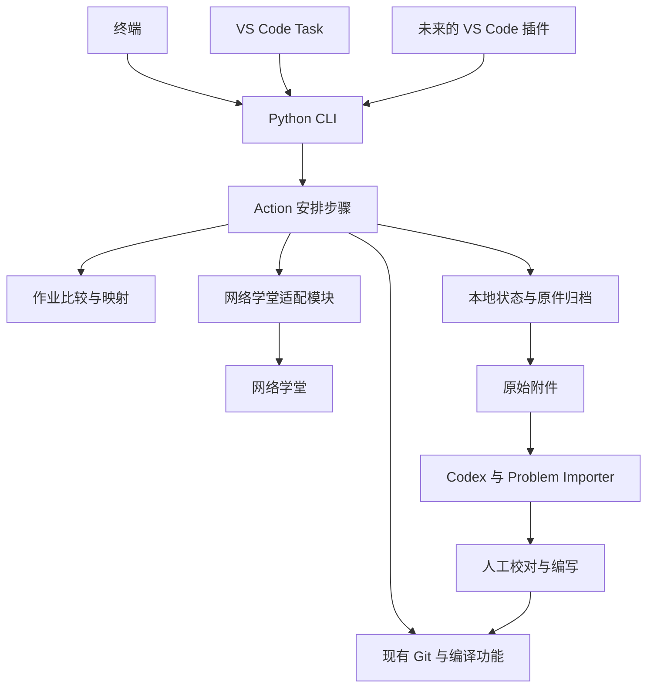

# Homework 自动化实践学习计划

本计划由用户与 AI 讨论，并由 AI 辅助整理。进度记录截至 2026 年 11 月 14 日。这是一份临时工作计划，每完成一个小阶段，再根据实际结果调整后续安排。

## 项目目标与协作方式

本项目同时服务于两个目标。一方面，让计算机承担重复、规则明确的作业管理操作。另一方面，通过实际开发学习 Python、测试、调试和工程判断。

- 本地确定性程序负责获取数据、识别变化、归档文件、维护映射、检查状态，以及执行已经授权的操作。
- Codex 负责题目转录、公式与图形处理、必要的翻译、知识问答、只读检查，以及辅助设计和审查代码。
- 用户负责作业内容的编写与校对、课程和作业对应关系的确认，以及远程 Git、文件覆盖和正式提交等操作的授权。
- 简单功能优先由用户设计和实现。AI 先审查、解释和提示，修改方案保持在用户能够理解的范围内。
- 每个小阶段重点学习一两个概念，使用与风险相称的测试验收。已经掌握的重复操作交给工具执行。

## 当前进度

| 阶段 | 状态 | 已有结果或下一步 |
|---|---|---|
| 0. 学习当前已有代码 | 当前阅读目标已完成 | 已理解入口、公共模块和部分 Action，其余 Action 按需要补读 |
| 1. 本地调用 | 已完成 | VS Code 的 Homework Status Task 与终端输出一致 |
| 2. 离线识别与映射 | 进行中 | 已实现比较函数，4 个持久化单元测试通过；下一步读取 JSON 快照 |
| 3. 网络学堂只读读取 | 待开展 | 验证平台访问方式和一个真实课程的读取 |
| 4. 附件归档 | 待开展 | 先用本地假文件验证，再接入实际下载 |
| 5. 初始化与转录整合 | 待开展 | 对接现有 Manager 和 Problem Importer |
| 6. 辅助提交 | 待开展 | 准备 PDF、人工提交和核验服务端状态 |

已有新增实现与配置如下。

- [VS Code Task](/Users/chenghaoyi/Homework/.vscode/tasks.json)
- [作业比较函数](/Users/chenghaoyi/Homework/.agents/skills/homework-manager/scripts/assignment_data.py)
- [比较函数测试](/Users/chenghaoyi/Homework/.agents/skills/homework-manager/tests/test_assignment_data.py)

当前保存的 4 个测试覆盖新增作业、截止时间更新、旧列表重复身份、新列表重复身份。此前的临时验证还覆盖空输入、换序、不同课程使用相同作业 ID、旧记录缺失、输出顺序和输入保持原样等场景，后续按需要将这些场景补入回归测试。

## 整体架构

以现有 Python CLI 为共同入口，终端、VS Code Task 和未来的轻量插件调用同一套规则与操作。

| 部分 | 职责与接口方向 |
|---|---|
| CLI 与 Action | 解析参数、安排步骤、展示结果，执行前核对目标和授权 |
| 作业数据处理 | 接收普通 Python 数据，返回比较结果和映射判断，便于独立测试 |
| 网络学堂适配 | 封装选定客户端，将平台字段、分页和会话行为转换为内部约定 |
| 本地存储 | 保存完整快照、平台与本地作业的绑定、原件及归档记录 |
| 现有 Manager | 复用课程和作业初始化、Git 检查、同步、合并及编译功能 |
| Codex 转录 | 根据明确的原件、目标文件和题目范围执行现有 Importer 流程 |

新增模块围绕已经出现的职责逐步组织。优先使用普通函数、字典、列表、JSON 和现有工具。

## 阶段 0 · 学习当前已有代码

用 AI 辅助理解此前由 AI 编写的实现，沿着一次命令追踪参数、函数调用、结果和失败路径。已阅读的主线包括 `homework.py`、`common.py`、`Status`、`NewHomework`、`Compile` 和 `Sync`。其余 Action 在实际需要时补读。

学习方式以自己预测、源码核对和小范围验证为主。能解释操作在哪里发生、错误如何传回入口，以及失败后留下什么状态，即可继续开发。

## 阶段 1 · 本地调用

**实际问题**　日常状态查询需要一个便捷入口，使已经确定的命令可以直接运行。

**技术方案**　配置 VS Code 的 `process` Task，指定 Python 程序、参数数组和仓库工作目录，调用现有 `Status`。

**用户实践**　亲自编写 Task，对照终端运行结果核对配置。此步骤已经完成。

**重点知识**　可执行程序与参数的关系、工作目录及退出码。

**验收与风险**　Task 和终端指向同一仓库，显示一致的分支和工作区状态，正常结束并可重复调用。新增 Task 时继续明确工作目录和具体命令。

## 阶段 2 · 离线识别、JSON 快照与本地映射

**实际问题**　程序需要识别同一份平台作业的新增和更新，并记住它对应哪份本地作业。

**技术方案**

- 用 `(course_id, assignment_id)` 识别平台作业，初期记录包含 `title` 和 `due_at`，时间先使用统一格式的字符串。
- `compare_assignments(previous, current)` 返回 `(new, updated)`，两个列表保存当前快照的完整记录，并保持当前顺序。
- 相同身份的标题或截止时间变化时归入更新。任意一份输入中出现重复身份时抛出 `ValueError`。
- 将列表输入接到 JSON 文件读取，先用手写的旧、新快照练习，再加入课程和作业绑定。
- 课程绑定关联平台课程与仓库课程目录，作业绑定关联平台作业与本地编号。绑定经人工确认后保存，标题、截止时间变化时继续使用原绑定。
- 本地状态初期采用 JSON，放在仓库外的可配置数据目录，便于跨作业分支使用和备份。

**用户实践**　已完成比较函数和基础 `unittest`。接下来自己实现 JSON 读取，再做模拟数据下的绑定查询和保存。

**重点知识**　当前重点为 JSON 与文件读取，随后学习身份与可变属性的区别，以及重复执行时的数据一致性。

**验收与风险**

- [x] 比较函数识别新增和更新，并检查两份列表内的重复身份。
- [x] 4 个基础单元测试通过，退出码为 `0`。
- [ ] 从两份手写 JSON 快照读取列表，并复用比较函数。
- [ ] 验证文件缺失、JSON 格式错误和数据结构错误的处理。
- [ ] 用模拟数据确认课程映射和作业绑定，重复运行保持同一份绑定。
- [ ] 一次列表缺项时保留既有绑定，等待后续核对。
- [ ] 保存状态时先完成校验，再通过临时文件替换正式文件，验证失败保留原记录。

真实平台接入时还需要核实两个 ID 的作用范围，确认内部身份约定足以区分作业。

## 阶段 3 · 网络学堂只读读取

**实际问题**　将人工准备的列表替换为真实平台数据，减少手动发现新作业和截止时间变化的工作。

**技术方案**　先核实平台允许的访问方式，在独立适配模块中封装选定客户端。先读取一个学期的一门课程，将结果转换成阶段 2 使用的记录格式，再验证分页和列表完整性。

已有公开资料初查涉及以下项目。选型时重新核对维护状态、许可证、认证方式、依赖和真实兼容性。

- [learn2018-autodown](https://github.com/Trinkle23897/learn2018-autodown)
- [thulearn2018](https://github.com/euxcet/thulearn2018)
- [learnX](https://github.com/robertying/learnX)
- [learnX 使用的独立 thu-learn-lib 分支](https://github.com/robertying/thu-learn-lib)

**用户实践**　使用脱敏响应样本实现字段转换，核对平台页面与程序结果。AI 协助调查客户端、认证和网络失败行为。

**重点知识**　HTTP 响应、身份认证与会话失效，以及模块接口。

**验收与风险**

- 官方网页与程序读取的课程、作业、截止时间和附件描述逐项对应。
- 覆盖分页、字段缺失、超时和会话过期，读取失败时保留上一次完整快照。
- 原始账号凭据、Cookie 和令牌仅在明确授权的本地认证流程中处理，妥善存放并控制日志内容。
- 对外传给比较模块的数据使用内部格式，使平台变化集中在适配模块中处理。

## 阶段 4 · 附件下载与原件归档

**实际问题**　完整保存原始题目及其更新版本，并在下载中断后能够继续处理。被 Git 忽略的 PDF 需要独立的恢复途径。

**技术方案**　原件首先归档到仓库外，记录平台身份、附件来源、原始文件名和内容哈希。相同内容复用，同名新版独立保存。下载先写临时文件，验证成功后进入正式归档。

**用户实践**　先用本地假文件完成命名、哈希比较和归档记录，再接入网络下载。

**重点知识**　`pathlib`、文件哈希、临时文件与中断恢复。

**验收与风险**

- 覆盖中断、重复下载、同名不同内容、异常文件名和路径越界。
- 验证下载结果确为预期附件，识别会话过期返回的登录页等异常内容。
- 分别记录附件已被发现和已完整归档的事实，未完成项在下次运行时继续处理。
- 归档和映射纳入备份，并实际恢复一份文件验证恢复流程。
- 将所需原件复制到作业目录时遵循现有 Skill 的保留与冲突处理规则，并核对暂存范围。

## 阶段 5 · 初始化与题目转录整合

**实际问题**　把平台作业准确关联到本地分支、目录和转录目标，处理初始化中途失败与重复执行。

**技术方案**　准备包含平台作业、课程、编号、分支和远程动作的初始化计划。人工确认后调用现有 `NewHomework`，核对实际创建结果后更新绑定与进度。随后准备原件和目标 `.tex`，使用现有 Problem Importer。

**用户实践**　实现待确认摘要，使用隔离仓库和一份历史作业验证整条流程，并对照原件校对转录结果。

**重点知识**　多步骤操作的失败状态、重试与结果核验。

**验收与风险**

- 修复更新 `main` 后重新计算编号可能偏离预览目标的问题。执行前核对确认过的目标，变化时返回新的计划。
- 在隔离仓库验证目录或分支已存在、推送失败和重复执行，避免重复初始化或错误绑定。
- 本地创建与远程推送的进度根据实际结果记录，失败后能够检查并继续处理同一作业。
- 原件完整保留，转录后的公式、语言、题目顺序和图形由用户对照检查。
- 编译验证通过后检查相关页面的布局，结合原件确认内容。
- 若扩展合并与清理操作，核对分支 tip 的包含关系和远程清理目标。对同一仓库的自动写操作进行串行控制。

转录初期通过现有 Skill 交接。出现稳定的批处理需求时，再评估官方模型调用方式的必要性、可靠性和复杂度。

## 阶段 6 · 辅助提交

**实际问题**　确认待提交 PDF 对应正确作业，并取得服务端实际提交状态。

**技术方案**　复用 `Compile`，准备包含目标平台作业、截止时间和 PDF 的提交前摘要。初期由用户在官方网页提交，再核对服务端记录。提交接口的集成在平台要求和技术可行性明确后单独评估。

**用户实践**　编写提交前检查与摘要，学习如何选择可验证的完成依据。

**重点知识**　产物有效性、目标匹配，以及本地状态与服务端状态的关系。

**验收与风险**

- 测试 PDF 缺失、编译失败、产物过期和错误映射。
- 编译结果、Git 同步情况和平台提交状态分别根据实际证据更新。
- 正式提交前明确授权，提交结果通过对应作业的服务端记录核对。
- 上传中断或结果不明确时，先查服务端状态，再决定后续处理。

## 未来的轻量 VS Code 插件接口

插件先提供刷新和展示，再按实际需要逐项接入写操作。

- 以现有 CLI 作为进程接口。TypeScript 收集选择并展示结果，Python 执行规则和文件、Git 操作。
- 第一条机器接口拟为 `Status --json`。届时提取状态收集逻辑，让文本展示和 JSON 展示使用同一份数据。
- JSON 带 `schema_version`。成功结果写入标准输出，诊断写入标准错误，失败返回非零退出码。`next_number` 作为显示提示，创建时重新校验。
- 插件集中解析 JSON，检查返回结构和接口版本。测试中文与空格路径、进程启动失败和非零退出码。
- 从受信任的工作区调用选定仓库入口，通过 `spawn` 的参数数组启动，并明确工作目录。
- 接入写操作时，CLI 提供结构化计划，插件展示并收集确认，Python 执行前复核目标与状态。

## 当前下一步

先推进阶段 2 的 JSON 读取小任务。

1. 手工准备两份包含模拟作业的旧、新 JSON 快照。
2. 编写读取函数，将文件转换为约定的 Python 列表。
3. 将读取结果交给现有比较函数，核对新增和更新结果。
4. 用临时文件测试正常读取、缺失文件、非法 JSON 和不符合约定的结构。

完成并审查这个小任务后，再确定映射和状态保存的具体实现。后续文件写入、Git 操作、真实账号接入和提交，均在对应阶段按仓库规则核对范围和授权。
