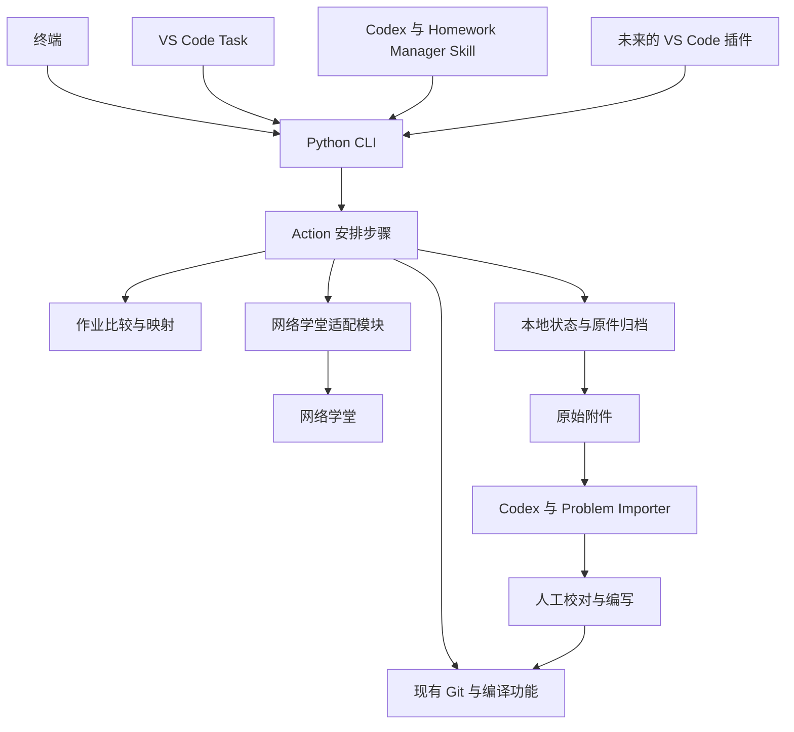

# Homework 自动化实践学习计划

本计划由用户与 AI 讨论，并由 AI 辅助整理。最近核对日期：2026 年 11 月 23 日。它持续记录整体方向、实际进度和当前任务，每完成一步同步更新，再根据结果决定后续安排。

## 计划的使用与更新

- 每次确定或执行“下一步”前，先核对“当前进度”、所属阶段和文末“当前下一步”，再按需读取相关代码与测试。恢复上下文时也从这里核对。
- 完成一个小任务后，在同一轮更新完成状态、验证依据、剩余问题和下一步。实现存在但未验证、仅有临时检查、已经有持久化测试，应分别说明。
- 文档用于表达目标与决定，实际代码和测试用于核验实现。发现不一致时先查明原因，再修正文档或实现；不能仅靠测试通过判断方向正确。
- 用户的新要求和仓库安全规则继续适用。重要范围或架构调整先说明取舍；候选方案不能直接记成已经确定的决定。
- 概念问答不必逐次记日志。主线进度改变或形成重要决定时才更新，保持一份计划即可。

## 项目目标与协作方式

本项目同时服务于两个目标。一方面，让计算机承担重复、规则明确的作业管理操作。另一方面，通过实际开发学习 Python、测试、调试和工程判断。

- 本地确定性程序负责获取数据、识别变化、归档文件、维护映射、检查状态，以及执行已经授权的操作。
- Codex 负责题目转录、公式与图形处理、必要的翻译、知识问答、只读检查，以及辅助设计和审查代码。
- 用户负责作业内容的编写与校对、课程和作业对应关系的确认，以及远程 Git、文件覆盖和正式提交等操作的授权。
- 简单功能优先由用户设计和实现。AI 先审查、解释和提示，修改方案保持在用户能够理解的范围内。
- 用户说“下一步”默认是布置一个可由用户尝试的小任务，不等于授权 AI 代写业务实现。只有用户明确交给 AI，或双方已明确该部分由 AI 主导时，才直接实现；稍复杂的任务先说明分工。代码审查以反馈为先，不直接接管用户代码。
- 用户现已将常规自动化测试委托给 AI 编写和运行，以减少学习负担；AI 简要说明覆盖的预期行为和验证局限。该分工不扩展为代写业务实现，用户想亲自练习测试时再调整。
- 每个小阶段重点学习一两个概念，使用与风险相称的测试验收。已经掌握的重复操作交给工具执行。

## 当前进度

| 阶段 | 状态 | 已有结果或下一步 |
|---|---|---|
| 0. 学习当前已有代码 | 当前阅读目标已完成 | 已理解入口、公共模块和部分 Action，其余 Action 按需要补读 |
| 1. 本地调用 | 已完成 | VS Code 的 Homework Status Task 与终端输出一致 |
| 2. 离线识别与映射 | 已完成（离线范围） | 2.7 跨 Action 场景已通过；完整 96 项测试通过 |
| 3. 网络学堂只读读取 | 进行中 | 用户编写的会话输入函数已通过假输入测试；CLI、会话保存与正式读取尚未接通 |
| 4. 附件归档 | 待开展 | 先用本地假文件验证，再接入实际下载 |
| 5. 初始化与转录整合 | 待开展 | 对接现有 Manager 和 Problem Importer |
| 6. 辅助提交 | 待开展 | 准备 PDF、人工提交和核验服务端状态 |

已有新增实现与配置如下。

- [VS Code Task](/Users/chenghaoyi/Homework/.vscode/tasks.json)
- [Homework Manager 使用手册](tools/homework/README.md)：面向使用者的业务流程、JSON 约定、CLI 参数与示例；由 AI 辅助编写。
- [数据处理与类型约定](tools/homework/scripts/assignment_data.py)：比较、课程映射、绑定索引和新增绑定。
- [JSON 存储](tools/homework/scripts/assignment_storage.py)：读取快照、课程映射、绑定，通过临时文件替换保存绑定，以及复制到固定 `.bak` 文件。
- [比较 Action](tools/homework/scripts/actions/compare_assignments.py)：`CompareAssignments --previous ... --current ... [--course-mapping ...] [--bindings ...]`，只读显示新增、更新、默认课程和具体绑定；默认课程差异仅提示。
- [绑定 Action](tools/homework/scripts/actions/bind_assignment.py)：默认预览，`--apply` 时先备份再保存；相同绑定不写入，失败不报告成功。
- [平台数据适配](tools/homework/scripts/learn_data.py)及[对应测试](tools/homework/tests/test_learn_data.py)：将 fork 的作业记录转换为内部快照，复用重复身份检查。
- [Node 进程通信](tools/homework/scripts/learn_bridge.py)及[对应测试](tools/homework/tests/test_learn_bridge.py)：捕获独立的输出与诊断，校验 JSON 后复用字段转换；当前仅接假数据脚本，无 npm 依赖。
- [Node 客户端目录](tools/homework/node/)：`package.json` 固定客户端 9.1.4，锁文件保留实际依赖版本；本地加载检查已通过，`node_modules` 被局部忽略。
- [会话接口测试](tools/homework/node/session.test.mjs)：假 Cookie、假令牌与模拟 fetch 验证恢复、失效及令牌缺失；不访问真实账号。
- [会话输入函数](tools/homework/scripts/actions/import_session.py)及[对应测试](tools/homework/tests/test_import_session.py)：用户编写输入函数，AI 按授权编写假输入测试；未注册为 CLI Action。
- [数据处理测试](tools/homework/tests/test_assignment_data.py)、[存储测试](tools/homework/tests/test_assignment_storage.py)、[CLI 与管理行为测试](tools/homework/tests/test_homework.py)。

最近完整验证：2026-11-23，数据处理 14 项、存储 37 项、CLI 与管理行为 46 项、平台数据转换 5 项、进程通信 10 项、用户输入函数测试 7 项，共 119 项 Python 测试，以及 3 项 Node 会话接口测试，均通过且无跳过，退出码 `0`。当前验证用户重新编写的输入函数及失败处理，未恢复原先撤回的 CLI、存储或权限实现。

```sh
python3 -B -m unittest discover -s tools/homework/tests -v
```

已有覆盖包括比较及重复身份、课程映射与输入保持、绑定唯一性与重复添加、文件读取异常、安全保存及失败时保留原记录，以及 CLI 的预览、写入、差异提示、错误处理和跨 Action 的离线流程。真实平台访问尚未开展；离线验收不代表已经核实网络学堂兼容性或真实列表完整性。

## 整体架构

以独立程序的 Python CLI 为共同入口，终端、VS Code Task、AI Skill 和未来的轻量插件调用同一套规则与操作。

**程序与 Skill 的边界（用户于 2026-11-23 确定，AI 辅助迁移）**

- `tools/homework/` 保存程序的 `scripts/`、`tests/`、`node/` 和 README。业务规则、输入校验与文件及 Git 操作均由程序执行；运行程序不需要加载 Skill。
- `.agents/skills/homework-manager/SKILL.md` 只指导 AI 选择公开 Action、核对授权与处理失败，通过 CLI 调用程序。参数和业务流程手册统一放在程序 README，Skill 链接引用。
- 本轮保留现有模块和导入组织，只迁移位置与相关路径；入口为 `python3 tools/homework/scripts/homework.py <Action> [options]`。默认仓库仍从程序位置解析，`--repo-path` 保持原有用途；旧入口已移除，仓库内引用与 VS Code Task 已更新。
- 程序继续维护在当前仓库。以后是否打包安装或迁往独立仓库，按实际需要决定；当前无需增加发布与安装流程。



| 部分 | 职责与接口方向 |
|---|---|
| CLI 与 Action | 解析参数、安排步骤、展示结果，执行前核对目标和授权 |
| 作业数据处理 | 接收普通 Python 数据，返回比较结果和映射判断，便于独立测试 |
| 网络学堂适配 | 封装选定客户端，将平台字段、分页和会话行为转换为内部约定 |
| 本地存储 | 保存完整快照、平台与本地作业的绑定、原件及归档记录 |
| 现有 Manager | 复用课程和作业初始化、Git 检查、同步、合并及编译功能 |
| Codex 转录 | 根据明确的原件、目标文件和题目范围执行现有 Importer 流程 |

新增模块围绕已经出现的职责逐步组织。优先使用普通函数、字典、列表、JSON 和现有工具。

## 阶段 0 · 学习当前已有代码

用 AI 辅助理解此前由 AI 编写的实现，沿着一次命令追踪参数、函数调用、结果和失败路径。已阅读的主线包括 `homework.py`、`common.py`、`Status`、`NewHomework`、`Compile` 和 `Sync`。其余 Action 在实际需要时补读。

学习方式以自己预测、源码核对和小范围验证为主。能解释操作在哪里发生、错误如何传回入口，以及失败后留下什么状态，即可继续开发。

## 阶段 1 · 本地调用

**实际问题**　日常状态查询需要一个便捷入口，使已经确定的命令可以直接运行。

**技术方案**　配置 VS Code 的 `process` Task，指定 Python 程序、参数数组和仓库工作目录，调用现有 `Status`。

**用户实践**　亲自编写 Task，对照终端运行结果核对配置。此步骤已经完成。

**重点知识**　可执行程序与参数的关系、工作目录及退出码。

**验收与风险**　Task 和终端指向同一仓库，显示一致的分支和工作区状态，正常结束并可重复调用。新增 Task 时继续明确工作目录和具体命令。

## 阶段 2 · 离线识别、JSON 快照与本地映射

**实际问题**　程序需要识别同一份平台作业的新增和更新，并记住它对应哪份本地作业。

**技术方案**

- 用 `(course_id, assignment_id)` 识别平台作业，初期记录包含 `title` 和 `due_at`，时间先使用统一格式的字符串。
- `compare_assignments(previous, current)` 返回 `(new, updated)`，两个列表保存当前快照的完整记录，并保持当前顺序。
- 相同身份的标题或截止时间变化时归入更新。任意一份输入中出现重复身份时抛出 `ValueError`。
- 将列表输入接到 JSON 文件读取，先用手写的旧、新快照练习，再加入课程和作业绑定。
- 课程映射提供未绑定作业的默认课程建议；具体作业绑定保存经人工确认的完整本地位置。已有作业绑定优先，标题、截止时间或默认课程变化不自动改写它，详见下文“绑定语义与处理顺序”。
- 本地状态初期采用 JSON，放在仓库外的可配置数据目录，便于跨作业分支使用和备份。

**用户实践**　用户已实现比较、映射、绑定、JSON 读写和 Action 保存的主要逻辑。AI 负责审查、备份函数、测试与 CLI 接通；按用户本轮请求，用一个可重复运行的集成测试完成 2.7，复用已有夹具，没有新增生产函数或测试框架。

**重点知识**　已经练习 JSON、异常、临时文件、稳定身份查询、预览与执行的边界，以及重复执行与数据保存。2.7 重点是从业务预期设计集成测试：通过真实 CLI 的输出和保存结果核对模块配合。类型标注整理已暂时收尾。

### 阶段 2 的小任务与边界

| 小任务 | 状态 | 结果与验收 |
|---|---|---|
| 2.1 离线比较与课程映射 | 已完成 | 普通字典与列表输入；区分新增、更新、已映射和未映射；不修改输入 |
| 2.2 读取 JSON | 已完成，读取回归已修复 | 身份校验已移到字段与类型检查之后，当前 37 项存储测试通过 |
| 2.3 绑定处理与保存函数 | 已完成 | 双向唯一性、重复添加不重复记录、冲突拒绝；保存前校验，失败保留原记录 |
| 2.4 比较与课程映射 CLI | 已完成 | 新旧快照与可选课程映射接入；显示身份、标题、截止时间和本地课程；顺序与原件保持 |
| 2.5 只读绑定查询 CLI | 已完成 | 绑定展示、顺序、输入保持、默认课程差异提示、错误处理与只读约束通过持久化测试，已更新 Skill 文档 |
| 2.6 人工确认绑定并落盘 | 已完成 | CLI 已开放 `--apply`；预览、保存、重复执行、重新读取及失败处理通过隔离测试，Skill 已同步 |
| 2.7 离线流程验收 | 已完成 | 一个集成测试串联比较、绑定预览、保存和查询，验证其他绑定保留、快照缺项不删除、重复执行不改备份；完整测试通过 |

`BindAssignment` 的入口与预览/执行方式已确定。当前所有数据文件通过路径参数指定；实际状态按原设计保存在仓库外，默认目录及配置方式尚未实现，不因此增加通用工作流框架。

### 已确定的接口选择

- 平台身份使用 `(course_id, assignment_id)`；本地位置使用 `(local_course, local_number)`，标题和截止时间不参与身份判断。
- 数据结构的字段约定集中在 `assignment_data.py`，存储校验放在 `assignment_storage.py`，Action 安排步骤与展示结果。
- `TypedDict` 说明已有字典记录，保留普通字典及运行时校验。新增公共接口优先标注；只读输入可用 `Sequence`、`Mapping`，返回类型说明实际容器。旧模块暂不批量补标注，不引入复杂泛型或新的检查框架。
- CLI 不传可选参数时保持已有输出；错误写入 `stderr`，非零退出。只读查询不自动创建、保存或修复绑定。
- `save_bindings` 是底层保存函数，调用方必须先取得相应写入授权；临时文件替换不能替代备份，也不代表支持并发写入或保证断电恢复。现阶段按单进程、串行的模拟流程验收。

### 绑定语义与处理顺序

本节于 2026-11-20 根据用户要求、由 AI 辅助明确，作为后续实现和验收依据。它替代此前“默认课程与绑定课程不同就终止只读查询”的规则；查询与差异提示已在 2.5 接通，确认与保存已在 2.6 验收。

| 数据 | 含义 | 权限与用途 |
|---|---|---|
| `course_mapping[course_id] = local_course` | 为尚未绑定的作业提供默认课程建议 | 不确定具体编号，不自动创建作业，也不修改已有绑定 |
| `bindings` 中的 `(course_id, assignment_id) → (local_course, local_number)` | 这项作业经人工确认的完整本地位置 | 已绑定作业的目标依据；保留自身的 `local_course`，不从当前默认值重新推导 |
| `MappedAssignment` | 根据默认映射补充了候选课程的临时记录 | 尚不表示人工确认，也不表示已经创建本地作业 |
| `binding_index` | 根据绑定列表生成的内存查询字典 | 用于查询与唯一性检查，不是第三份持久化关系 |

**查询与目标准备**

1. 加载绑定记录后，先按 `(course_id, assignment_id)` 查询已有绑定。有绑定就使用其完整目标，不用默认课程替换它。
2. 确认未绑定后，才用课程映射建议课程。没有课程映射则等待用户选择；有默认课程仍然不能推导本地作业编号。
3. 未提供 `--bindings` 只表示本次没有查询绑定，不能据此断言作业尚未绑定。后续写入前必须读取实际要更新的绑定文件。
4. 标题、截止时间或默认课程变化，以及一次快照缺项，都不自动更新或删除已有绑定。不按标题相似度重新绑定。

**默认课程与已有绑定不同**

- 这表示默认建议与已确认位置有差异，不等同于绑定记录无效。只读查询继续展示，目标以具体作业绑定为准。
- 在同时提供两份数据且本次显示记录确有差异时，向 `stderr` 输出 `WARNING:` 提示，包含平台两个 ID、默认课程和已绑定课程；正常结果写入 `stdout`，仅此差异不改变成功退出码 `0`。
- 默认映射缺少课程键、未提供其中一个来源，或差异只涉及未显示的作业时，不产生这项提示。不得自动修改任意来源。
- 保留现有 `Local course` 标签，明确它展示课程映射中的默认建议；`Local assignment` 展示具体绑定目标。两行可不同，差异用上述提示解释。

例如默认课程为 `Analysis-1`，已有绑定为 `Algebra-1/7` 时，继续显示这两个值并提示差异；查询和后续针对既有作业的操作使用 `Algebra-1/7`。显示绑定不代表已经验证本地目录或 PDF 存在，执行实际操作前仍由对应管理流程检查。

**确认与保存**

1. 写入 Action 加载实际绑定存储，先查已有关系。相同关系重复确认时保持原样；试图给已有平台身份换目标，或占用已被其他作业绑定的本地目标时，拒绝自动修改。
2. 对未绑定作业，用默认课程准备建议，允许用户明确选择其他课程。展示最终的平台身份、课程、编号及数据文件，取得确认后再执行。默认值不是写入授权。
3. 阶段 2.6 只处理人工确认的现有本地作业对应关系，并检查目标。实际新建目录和分支留到阶段 5，复用 `NewHomework`，核验创建结果与确认目标一致后再登记绑定。
4. 确认后调用 `add_assignment_binding` 生成新列表，再调用 `save_bindings` 保存整份列表，保留其他记录。不能用当前快照重建并覆盖绑定列表，也不能把新默认值套到旧绑定上后强行保存。
5. 真正的数据错误仍报错：无效 JSON、错误字段、重复平台身份或重复本地目标等。原文件不自动修复。首次使用由用户显式准备 `[]` 绑定文件，缺失文件不能默认为已有空记录。
6. 当前不提供改绑或迁移功能；将来确有需求时单独设计授权、目标核验和恢复方式。

**实现职责**

- Action 安排读取、先查绑定、查询默认建议、展示和确认的顺序；2.5 只读 Action 不调用保存函数。
- `assignment_data.py` 保留纯数据规则：课程映射、建立索引、绑定唯一性和重复添加。只有规则出现多个调用位置或明显变复杂时，再提取共同的目标解析函数。
- `assignment_storage.py` 负责单份文件的读取、字段校验和保存，不替用户选择目标，也不隐式读取另一份文件决定优先级。
- 本节是已确定的行为规范，不能仅凭现有类型定义或某个函数存在就认定整条流程已实现。

**验收与风险**

- [x] 比较函数识别新增和更新，并检查两份列表内的重复身份。
- [x] 从两份 JSON 快照读取列表并比较，通过 CLI 显示结果。
- [x] 身份校验放在字段与类型检查之后，文件缺失、JSON 格式错误和数据结构错误的既有处理通过存储测试；快照重复身份由共享函数检查。
- [x] 课程映射读取及 CLI 显示，未映射记录不丢失，数量和顺序保持。
- [x] 函数层验证绑定双向唯一性、重复添加、标题或截止时间变化后绑定保持。
- [x] 保存前校验，通过临时文件替换正式文件，测试写入和替换失败时保留原记录。
- [x] 绑定查询 CLI 遵循已有绑定优先，课程映射差异仅提示，有对应的持久化测试。
- [x] 预览后显式执行绑定并保存、重读的实际 CLI 调用流程，在隔离仓库通过验证。
- [x] 模拟快照缺项后核对旧绑定仍完整保留，不根据一次缺项自动删除绑定。
- [x] 完成 2.7 自动化离线验收，已满足本阶段约定范围；下一步进入阶段 3 的公开资料调查，尚未开展真实账号访问。

真实平台接入时还需要核实两个 ID 的作用范围、学期区分和截止时间格式。当前只比较时间字符串，不能据此判断时区、逾期或平台数据完整性。阶段 2 不要求提前解决平台登录、下载、GUI 或提交。

## 阶段 3 · 网络学堂只读读取

**实际问题**　将人工准备的列表替换为真实平台数据，减少手动发现新作业和截止时间变化的工作。

**技术方案**　先核实平台允许的访问方式，在独立适配模块中封装选定客户端。先读取一个学期的一门课程，将结果转换成阶段 2 使用的记录格式，再验证分页和列表完整性。

已有公开资料初查涉及以下项目。选型时重新核对维护状态、许可证、认证方式、依赖和真实兼容性。

- [learn2018-autodown](https://github.com/Trinkle23897/learn2018-autodown)
- [thulearn2018](https://github.com/euxcet/thulearn2018)
- [learnX](https://github.com/robertying/learnX)
- [原始上游 thu-learn-lib](https://github.com/Harry-Chen/thu-learn-lib)
- [learnX 使用的独立 thu-learn-lib 分支](https://github.com/robertying/thu-learn-lib)

### 3.1 公开调查结果

以下由 AI 于 2026-11-23 核对 README、许可证、默认分支提交、依赖及相关源码；没有安装、运行客户端或登录真实账号。提交时间表示维护证据，不等于兼容性证明。

| 项目 | 默认分支最近提交 | 许可证 | 复用判断 |
|---|---|---|---|
| learn2018-autodown | [2025-09-19，4b5bd470](https://github.com/Trinkle23897/learn2018-autodown/commit/4b5bd47070f51a49ba8a6eab323eddf6f5e5923e) | [MIT](https://github.com/Trinkle23897/learn2018-autodown/blob/4b5bd47070f51a49ba8a6eab323eddf6f5e5923e/LICENSE) | Python 下载工具；可参考接口和浏览器登录，读取与下载/归档耦合，不能直接整套接入 |
| thulearn2018 | [2024-09-17，01c1e51d](https://github.com/euxcet/thulearn2018/commit/01c1e51d393105542f36828dcceb54fff3ce81c9) | [MIT](https://github.com/euxcet/thulearn2018/blob/01c1e51d393105542f36828dcceb54fff3ce81c9/LICENSE) | Python CLI；功能齐全，但认证、凭据存储和读取副作用不适合直接沿用 |
| learnX | [2026-11-23，2c148b0f](https://github.com/robertying/learnX/commit/2c148b0f804b6062dd5ffa0d647f145c50960a5e) | [带额外限制的 MIT 文本](https://github.com/robertying/learnX/blob/2c148b0f804b6062dd5ffa0d647f145c50960a5e/LICENSE)，不能简称标准 MIT | 完整 React Native 应用，整体接入成本高；当前依赖独立库 9.1.4，可作为使用线索 |
| Harry-Chen/thu-learn-lib | [2026-10-02，07fac46a](https://github.com/Harry-Chen/thu-learn-lib/commit/07fac46a3cee98fc88cb76faf4344ea67697b274) | [标准 MIT](https://github.com/Harry-Chen/thu-learn-lib/blob/07fac46a3cee98fc88cb76faf4344ea67697b274/LICENSE) | 原始上游也在维护，仓库版本 4.2.6；课程与作业接口覆盖当前需求，应纳入首轮对照验证 |
| robertying/thu-learn-lib | [2026-11-22，0305ee55](https://github.com/robertying/thu-learn-lib/commit/0305ee55364546bc604c7af8bae183400956a952) | [标准 MIT](https://github.com/robertying/thu-learn-lib/blob/0305ee55364546bc604c7af8bae183400956a952/LICENSE) | 用户已选择作为验证对象；独立 TypeScript 库，调查版本 9.1.4，Node 运行要求为 >=22，真实兼容性待验证 |

**具体证据与局限**

- autodown 的依赖包含 `requests`、Beautiful Soup、`tqdm`、`gmssl` 和 Selenium。[登录源码](https://github.com/Trinkle23897/learn2018-autodown/blob/4b5bd47070f51a49ba8a6eab323eddf6f5e5923e/login_manager.py) 使用浏览器交互和会话文件，但会打印 Cookie/XSRF 值的部分内容、保存调试响应；`verify_session` 最终无条件返回成功。[作业同步源码](https://github.com/Trinkle23897/learn2018-autodown/blob/4b5bd47070f51a49ba8a6eab323eddf6f5e5923e/learn.py) 还会跳过单类作业列表的异常，存在部分数据被当成完整结果的风险。[2026-06 的 issue #38](https://github.com/Trinkle23897/learn2018-autodown/issues/38) 有用户修复编码后下载成功的报告，仅是局部使用证据。
- thulearn 的 [browser.py](https://github.com/euxcet/thulearn2018/blob/01c1e51d393105542f36828dcceb54fff3ce81c9/thulearn2018/browser.py) 用旧式账号密码表单登录，POST 设置 `verify=False`；读取截止时间会进入下载与文件写入流程。[README](https://github.com/euxcet/thulearn2018/blob/01c1e51d393105542f36828dcceb54fff3ce81c9/README.md) 说明会本地保存账号密码，[2026-01 的 issue #18](https://github.com/euxcet/thulearn2018/issues/18) 报告 `XSRF-TOKEN` 缺失。暂不作为直接依赖。
- learnX 主应用的额外许可条件涉及特定任职背景和项目资助来源。本项目无需复制主应用代码；独立库须按它自己的许可证评估，不能混用两者的许可结论。[应用 package.json](https://github.com/robertying/learnX/blob/2c148b0f804b6062dd5ffa0d647f145c50960a5e/package.json) 确认使用 `@robertying/thu-learn-lib` 9.1.4。
- 独立库的 [README](https://github.com/robertying/thu-learn-lib/blob/0305ee55364546bc604c7af8bae183400956a952/README.md) 提供 `getCurrentSemester`、`getCourseList`、`getHomeworkList`；Node 使用 Cookie jar。凭据登录涉及设备指纹，设备未获信任时不能靠反复重试解决；也支持携已有 Cookie 的会话，但能否复用实际账号会话尚未验证。[CHANGELOG](https://github.com/robertying/thu-learn-lib/blob/0305ee55364546bc604c7af8bae183400956a952/CHANGELOG.md) 有近期认证、超时和敏感 URL 处理修复，仓库包含真实环境测试代码，但本轮没有执行这些测试。
- 该库的真实环境测试也使用了开启旧式 TLS 重协商的 [OpenSSL 配置](https://github.com/robertying/thu-learn-lib/blob/0305ee55364546bc604c7af8bae183400956a952/test/live/openssl.cnf)。后续需先验证默认 TLS 环境，不能因库较新就假定网络环境问题已经解决，也不把放宽配置直接写入全局环境。

**补充原始上游与 fork 的比较（同日按用户提供的链接核对）**

初查只详细核对了 fork，候选比较不完整。原始上游并非停止维护；[package.json](https://github.com/Harry-Chen/thu-learn-lib/blob/07fac46a3cee98fc88cb76faf4344ea67697b274/package.json) 中的包名为 `thu-learn-lib`，仓库版本 4.2.6；fork 使用另一个包名 `@robertying/thu-learn-lib`，两者不能靠版本数字大小判断优劣。

- [上游源码](https://github.com/Harry-Chen/thu-learn-lib/blob/07fac46a3cee98fc88cb76faf4344ea67697b274/src/index.ts) 具备课程、学期和作业列表读取接口；作业列表默认逐项读取页面和描述，fork 则可只获取基本列表、按需加载详情。只做变化识别时，fork 的请求范围更贴合当前需求。
- 上游的 [Cookie 实现](https://github.com/Harry-Chen/thu-learn-lib/blob/07fac46a3cee98fc88cb76faf4344ea67697b274/src/cookie.ts) 在 Node 中维护一个封闭的简易内存 jar，忽略 Cookie 路径等属性；[HelperConfig](https://github.com/Harry-Chen/thu-learn-lib/blob/07fac46a3cee98fc88cb76faf4344ea67697b274/src/types.ts) 当前没有导入现有 jar、自定义 fetch 或请求超时的配置。fork 提供独立的 Node jar 接入和 `requestTimeout`，更方便隔离进程复用会话与控制读取失败。
- 上游 README 的“无需凭据登录”对应 `login()` 先尝试读取有效会话中的 CSRF token；这不意味着未认证也能读私有课程，Node 进程也不会自动继承浏览器会话。登录过期后仍需满足平台认证条件。
- 上游作业截止时间是 `Date`，源码使用 `new Date(h.jzsj)`；fork 通常返回带北京时间偏移的字符串。接入时必须验证服务端原始值和时区，不能直接混用两套时间处理方式。上游也有旧式 TLS 重协商配置，真实环境问题仍需验证。

**当前选择（2026-11-23）**　用户明确决定先使用 robertying fork，作为阶段 3 的接入验证对象。原始上游的对照记录保留，当前不再反复选型；两者的本账号兼容性均尚未实际验证。

**字段身份需要单独确认**　[学生作业源码](https://github.com/robertying/thu-learn-lib/blob/0305ee55364546bc604c7af8bae183400956a952/src/homework.ts) 将 `xszyid` 映射为 `id`，将 `zyid` 映射为 `baseId`；`title`、`deadline` 可对应内部标题和截止时间。候选方案是以课程上下文的 ID 和 `baseId` 构造内部作业身份，保留学生记录 ID 供将来提交使用；选择须在真实课程中核对，不直接用字段名猜测。截止时间通常带 `+08:00`，但库对不能识别的形态可能保留原字符串，实际格式仍需确认。

**平台使用要求**　查到 [2025 学生手册中的网络学堂管理办法，第十三条（PDF 第 161–162 页）](https://www.rxc.tsinghua.edu.cn/__local/A/DC/57/5676BB00C2D673752ADBA0D52D6_B626842D_1D58BD.pdf#page=161)：要求通过官方网站和入口访问，对其他访问方式不保证安全保护。本轮未找到公开开发者 API 或明确授权此类自动化的说明；开源实现和用户报告均不能替代适用要求的核对。真实验证前需明确合适的访问与人工认证方式，不绕过双因素认证。

**最小接入边界**　按已选择的 fork 推进：Python 保留当前 CLI、规则与存储，小型 Node 进程负责调用该库读取并输出 JSON，Python 将它转换为既有快照。网络与认证接入由 AI 主导，数据转换由用户实践。用户已安装 Node，模拟通信已验证，正式客户端依赖已安装并通过本地加载检查；人工认证、正式读取脚本及真实课程验证尚未实施。不创建 HTTP 服务、GUI、常驻进程，也不另写一套 Python 登录协议。

阶段二总流程、2.7 验收流程和阶段三目标流程，统一记录在 [程序 README 的业务流程部分](tools/homework/README.md)。阶段三图描述待实现的目标，不表示当前 CLI 已能联网读取、保存快照或自动推进比较基准。具体推进状态如下：

| 小步 | 状态 | 本步完成依据 |
|---|---|---|
| 3.1 客户端调查与选择 | 已完成 | 已核对公开源码与许可证，用户选择 fork；真实兼容性仍待验证 |
| 3.2 字段转换 | 已完成（约定输入范围） | 5 项新增测试通过，覆盖字段、顺序、输入保持、空列表和重复身份 |
| 3.3 最小 Node/Python 进程通信 | 模拟链路与客户端依赖已验证；正式读取待接入 | 10 项通信测试通过；客户端 9.1.4 可导入并初始化；真实平台访问尚未开始 |
| 3.4 一门真实课程只读验证 | 准备中；真实访问未开始 | 会话恢复接口的 3 项离线测试保留；本地输入和正式读取尚未实现，Chrome/代数-1 已选 |
| 3.5 快照与比较衔接 | 待开展 | 明确首次基准及保存接口；完整读取、校验和比较成功后才推进基准，失败保留旧快照；不修改绑定 |
| 3.6 阶段验收 | 待开展 | 模拟网络/会话/部分列表失败，核对旧快照保持；人工与官方网页逐项比对真实数据 |

推进比较基准表示已读取新信息，不表示作业已处理。首次基准及推进后未绑定记录的查询方式留到 3.5 明确，避免仅显示新增/更新导致待处理记录被忽略；不提前引入另一套任务状态模型。

**用户实践**　使用脱敏响应样本实现字段转换，核对平台页面与程序结果。AI 协助调查客户端、认证和网络失败行为。

**重点知识**　HTTP 响应、身份认证与会话失效，以及模块接口。

**验收与风险**

- 官方网页与程序读取的课程、作业、截止时间和附件描述逐项对应。
- 覆盖分页、字段缺失、超时和会话过期，读取失败时保留上一次完整快照。
- 原始账号凭据、Cookie 和令牌仅在明确授权的本地认证流程中处理，妥善存放并控制日志内容。
- 对外传给比较模块的数据使用内部格式，使平台变化集中在适配模块中处理。

## 阶段 4 · 附件下载与原件归档

**实际问题**　完整保存原始题目及其更新版本，并在下载中断后能够继续处理。被 Git 忽略的 PDF 需要独立的恢复途径。

**技术方案**　原件首先归档到仓库外，记录平台身份、附件来源、原始文件名和内容哈希。相同内容复用，同名新版独立保存。下载先写临时文件，验证成功后进入正式归档。

**用户实践**　先用本地假文件完成命名、哈希比较和归档记录，再接入网络下载。

**重点知识**　`pathlib`、文件哈希、临时文件与中断恢复。

**验收与风险**

- 覆盖中断、重复下载、同名不同内容、异常文件名和路径越界。
- 验证下载结果确为预期附件，识别会话过期返回的登录页等异常内容。
- 分别记录附件已被发现和已完整归档的事实，未完成项在下次运行时继续处理。
- 归档和映射纳入备份，并实际恢复一份文件验证恢复流程。
- 将所需原件复制到作业目录时遵循现有 Skill 的保留与冲突处理规则，并核对暂存范围。

## 阶段 5 · 初始化与题目转录整合

**实际问题**　把平台作业准确关联到本地分支、目录和转录目标，处理初始化中途失败与重复执行。

**技术方案**　准备包含平台作业、课程、编号、分支和远程动作的初始化计划。人工确认后调用现有 `NewHomework`，核对实际创建结果后更新绑定与进度。随后准备原件和目标 `.tex`，使用现有 Problem Importer。

**用户实践**　实现待确认摘要，使用隔离仓库和一份历史作业验证整条流程，并对照原件校对转录结果。

**重点知识**　多步骤操作的失败状态、重试与结果核验。

**验收与风险**

- 修复更新 `main` 后重新计算编号可能偏离预览目标的问题。执行前核对确认过的目标，变化时返回新的计划。
- 在隔离仓库验证目录或分支已存在、推送失败和重复执行，避免重复初始化或错误绑定。
- 本地创建与远程推送的进度根据实际结果记录，失败后能够检查并继续处理同一作业。
- 原件完整保留，转录后的公式、语言、题目顺序和图形由用户对照检查。
- 编译验证通过后检查相关页面的布局，结合原件确认内容。
- 若扩展合并与清理操作，核对分支 tip 的包含关系和远程清理目标。对同一仓库的自动写操作进行串行控制。

转录初期通过现有 Skill 交接。出现稳定的批处理需求时，再评估官方模型调用方式的必要性、可靠性和复杂度。

## 阶段 6 · 辅助提交

**实际问题**　确认待提交 PDF 对应正确作业，并取得服务端实际提交状态。

**技术方案**　复用 `Compile`，准备包含目标平台作业、截止时间和 PDF 的提交前摘要。初期由用户在官方网页提交，再核对服务端记录。提交接口的集成在平台要求和技术可行性明确后单独评估。

**用户实践**　编写提交前检查与摘要，学习如何选择可验证的完成依据。

**重点知识**　产物有效性、目标匹配，以及本地状态与服务端状态的关系。

**验收与风险**

- 测试 PDF 缺失、编译失败、产物过期和错误映射。
- 编译结果、Git 同步情况和平台提交状态分别根据实际证据更新。
- 正式提交前明确授权，提交结果通过对应作业的服务端记录核对。
- 上传中断或结果不明确时，先查服务端状态，再决定后续处理。

## 未来的轻量 VS Code 插件接口

插件先提供刷新和展示，再按实际需要逐项接入写操作。

- 以现有 CLI 作为进程接口。TypeScript 收集选择并展示结果，Python 执行规则和文件、Git 操作。
- 第一条机器接口拟为 `Status --json`。届时提取状态收集逻辑，让文本展示和 JSON 展示使用同一份数据。
- JSON 带 `schema_version`。成功结果写入标准输出，诊断写入标准错误，失败返回非零退出码。`next_number` 作为显示提示，创建时重新校验。
- 插件集中解析 JSON，检查返回结构和接口版本。测试中文与空格路径、进程启动失败和非零退出码。
- 从受信任的工作区调用选定仓库入口，通过 `spawn` 的参数数组启动，并明确工作目录。
- 接入写操作时，CLI 提供结构化计划，插件展示并收集确认，Python 执行前复核目标与状态。

## 当前下一步

**任务：3.4.4a 用户实现会话路径检查。状态：已说明最小保存方向和本步接口，路径检查尚未编写；输入函数已验收，保存和 CLI 尚未接入。**

**当前环境检查**　用户安装后，已实际确认 `node --version` 为 `v26.13.1`，`command -v node` 为 `/opt/homebrew/bin/node`，满足所选库 Node >=22 的运行要求。

**下一小步（用户实现，AI 审查与测试）**　新建 `tools/homework/scripts/session_storage.py`，编写 `validate_session_path(path: Path, repo_root: Path) -> Path` 和一句话 docstring。展开两条路径的 `~` 并解析绝对路径，拒绝目标文件本身为符号链接、解析后位于当前仓库内（含仓库根目录），以及已存在却不是普通文件的目标；失败抛 ValueError，成功返回规范化后的目标路径。不创建目录、不读写文件内容。目标链接的检查须在 resolve 前；父目录链接通过 resolve 后的归属检查处理。

**职责边界**　外部尚不存在的目标或外部已有普通文件都可以通过此路径检查；返回只表示位置与类型合适，不授予覆盖权限，后续实际写入仍须独立控制覆盖。该检查只针对所传入的 Homework 仓库范围。测试由 AI 用临时目录与假文件编写；用户当前只实现路径逻辑。

**保存方向（本轮说明，实际写入接口与分工随后明确）**　JSON 沿用输入字典的 cookie_header、csrf_token 两项字符串；默认位置建议沿用仓库外 `~/Library/Application Support/Homework/session.json`。这是明文会话缓存，创建时应限制文件权限为 600，新建专用目录考虑 700，已有文件覆盖须显式授权，不为可重新获取的会话保留历史备份。已有 save_bindings 的同目录临时文件与清理思路可借用，但其绑定校验和直接替换行为不能原样用于会话；暂不改旧模块或抽取通用框架。路径检查之后再讨论权限、失败及覆盖的具体实现，由双方先明确分工；本轮不代写生产代码。

**3.4.3 验收结果**　用户自行增加 warnings.catch_warnings/simplefilter 及异常转换，AI 未改实现。新增 4 个测试方法，分别在两次输入的位置模拟真实 warning、EOF 与 Ctrl-C，并检查正常返回、判空、告警、EOF 和中断后的警告过滤设置均恢复。验证了告警发生后不会继续到模拟明文回退；HomeworkError 保留异常原因且提示不含假输入；KeyboardInterrupt 原样传播。判空与 return 放在 with 内也正确，退出时会恢复设置。完整 Python 119 项和 Node 3 项通过且无跳过，退出码 `0`；这是模拟依赖的离线验证，未在真实终端采集凭据。

**3.4.2 验收结果**　用户明确委托 AI 编写测试；新增 `test_import_session.py` 的 3 个 unittest 方法，以 patch/side_effect 提供假值，覆盖正常返回和去除首尾空白、Cookie 为空串/纯空白、CSRF token 为空串/纯空白，并断言异常信息不包含另一项假输入值。完整 Python 115 项与 Node 3 项通过，无跳过，退出码 `0`。没有修改用户函数。这些测试只验证数据处理与判空，不证明实际终端隐藏输入可用。

**后续分工**　业务实现仍以用户先尝试为主；终端失败处理、文件权限与安全保存先解释方案，再确定由谁实现。常规测试按用户最新授权由 AI 编写运行。之后才接 CLI、Node 会话加载与正式读取，继续核对超时预算和真实平台 ID。实际采集会话留到读取入口就绪后，Agent 不读取真实 Cookie 或令牌内容。

**用户已提供的范围**　Chrome；首轮验证“代数-1”（本地目录为 `Algebra-1`）。“物理-1”有尚未下载的作业，保留为后续新增识别及阶段四附件下载的实际案例，不自动扩大为本轮下载、建作业或提交授权。

本步学习重点是读懂当前 JavaScript 的 import、const、对象与循环，以及读取接口将使用的 async/await；参考 [MDN const](https://developer.mozilla.org/zh-CN/docs/Web/JavaScript/Reference/Statements/const)、[MDN await](https://developer.mozilla.org/zh-CN/docs/Web/JavaScript/Reference/Operators/await) 和 [Node ESM](https://nodejs.org/api/esm.html)，按实际遇到的语法查阅即可。

### 3.4 已核对的会话接口与候选流程

AI 核对已安装 9.1.4 的 request/auth/cookies 源码与对应版本 README。`CookieJar.fromJSON` 可以恢复库自身保存的 Cookie jar，`setCSRFToken` 设置对应令牌，`ensureSession` 发起探测请求。Cookie jar 和浏览器 Cookie 导出不是同一格式，Node 不会自动继承浏览器会话；尚未验证具体浏览器导出及本账号可用性。

新增 `node/session.test.mjs`，用假数据并替换全局 fetch，验证三项行为：恢复 Cookie 和令牌后探测时两者均正确传出；服务端模拟 403 时返回 `NOT_LOGGED_IN` 且不进行密码登录；缺少令牌时返回 `NO_CREDENTIAL`，不把仅有 Cookie 当作可恢复会话。`npm --prefix tools/homework/node test` 的 3 项测试通过，无跳过，退出码 `0`。这些是客户端接口行为验证，不是服务器认证验证，也未新增生产环境会话加载代码。

**保存方向，尚未实现**　首次由用户在官方网页手工登录，再在本机准备会话。建议采用上文的仓库外两字段 JSON 与私有权限；当前仅布置路径检查，实际写入接口尚未确定。初期不保存密码或配置 CredentialProvider，会话过期停止并要求重新人工认证；Node 错误只输出可识别的失败原因，不打印完整响应、Cookie 或 URL 查询串。尚未采集真实会话或访问平台。

已核对 [Chrome Network 官方说明](https://developer.chrome.com/docs/devtools/network/reference/#view-http-headers)：单条请求的 Headers 显示 Request Headers，Payload 显示可解码的查询参数。候选交接方式为手工获取成功的网络学堂请求中的 Cookie 与 `_csrf`，通过本地隐藏输入交给工具，在 Node 内构造 Cookie jar；不要求用户直接生成 tough-cookie 序列化数据。此方法仍需实际页面核对。Chrome 默认的脱敏 HAR 会省略 Cookie，不能误当作已包含认证数据；不以导出整份浏览记录作为本步前提。

**正式读取前需处理**　现有 Python 桥接进程上限 30 秒，客户端默认单请求上限 60 秒。接入真实读取时应明确整个过程的时间预算与单请求上限并测试；本次模拟测试不修改这两个默认值。正式读取只核对一门课程，读失败不保存新快照，继续复用已有字段转换、比较及绑定规则。

### 已验收的程序与 Skill 分离

程序、测试、Node 依赖和 README 迁至 `tools/homework/`。移动前后校验 1550 份文件内容一致，随后只修改默认根目录层级、合并提交信息中的程序名称、迁移回归测试和手册路径；已有用户实现保持。Skill 精简为调用与安全规则，保留原件保存、完成作业授权及分支清理约定；Importer 的编译命令、VS Code Task、AGENTS、根 README 和计划同步更新。

完整 112 项测试通过，无跳过，退出码 `0`；其中新增一项验证程序可在没有 Skill 的隔离仓库中从外部目录调用。迁移后的 Node 加载检查、从临时目录运行真实 checkout 的只读 Status、VS Code Task 配置中的实际命令与 Node 依赖忽略规则均通过；没有打开 VS Code 界面执行 Task。保留已有 PDF 和其他用户改动，未提交、推送、合并、删除或切换真实仓库分支。文档与 Skill 的格式及链接检查结果见本轮最近记录。

### 3.3 已验收的客户端依赖准备

2026-11-23，AI 核对已调查 commit 的 `package.json`、README 和 Cookie 配置接口，建立独立目录 `tools/homework/node/`。直接依赖固定为 npm 官方仓库的 `@robertying/thu-learn-lib@9.1.4`，使用本机 Node v26.13.1、npm 11.20.0，生成 `package-lock.json`，共安装 32 个依赖包；`node_modules` 由局部 `.gitignore` 忽略。安装使用 `--ignore-scripts --no-audit --no-fund`，未执行依赖安装脚本或改动全局软件配置。

`check-client.mjs` 导入 `Learn2018Helper` 和 `cookieJarConfig`，创建空会话对象并检查 `getCurrentSemester`、`getCourseList`、`getHomeworkList` 存在。`npm run check` 和 `npm ls --depth=0` 均通过，退出码 `0`；实际安装包的名称、版本和仓库字段与预期一致。检查脚本只输出诊断文本，不提供作业列表，也不交给 Python 桥接函数调用；正式读取脚本尚未编写。

在全新临时目录复制配置、锁文件和检查脚本，使用本地缓存执行 `npm ci --offline --ignore-scripts --no-audit --no-fund`，32 个包成功重建，随后加载检查通过，退出码均为 `0`。完整 Python 回归 111 项通过，无跳过，退出码 `0`；文档本地链接、代码围栏和 `git diff --check` 通过。安装提示间接依赖 `whatwg-encoding@3.1.1` 已弃用，当前未因此修改上游依赖树；本次没有执行依赖漏洞审计。库加载成功仅证明本地依赖可用，不证明真实认证、网络接口或列表完整性。

### 3.3 已验收的模拟进程链路

AI 新增 `scripts/learn_bridge.py`，公开函数为 `read_node_homeworks(course_id: str, script_path: Union[str, Path]) -> list[Assignment]`。调用 `node <script_path> <course_id>`，参数通过列表传递，不拼接 shell 命令；分别捕获 UTF-8 标准输出与标准错误，超时为 30 秒。JSON 必须是列表，记录中的 `baseId`、`title`、`deadline` 必须为字符串；校验后调用用户原有 `normalize_homeworks`，未改写转换函数。

本步 Node 脚本位于 `tests/fixtures/mock_learn.mjs`，仅输出假数据和模拟诊断；不需要 npm 依赖。现有 `common.command` 合并标准错误与标准输出，不适合直接解析 JSON，因此此处独立捕获两条流。启动、超时、非零退出或格式错误均报错，不降级为空列表；原始诊断不自动显示。合法空列表仍有效，重复身份复用已有检查。

`test_learn_bridge.py` 的 10 项测试已通过：真实 Node 进程处理中文和空格路径、课程 ID 单参数传递、日志分流、空列表、非零退出，即使其输出是合法 JSON 也拒绝；同时验证无效 JSON、字段缺失或类型错误、重复身份及非 UTF-8。启动失败通过隔离 PATH 验证，超时通过模拟 `TimeoutExpired` 验证，未为测试真实等待 30 秒。缺少 Node 时真实通信测试会跳过，不能据此认定本步通过。

完整回归 111 项测试通过，无跳过，退出码 `0`；README 的调用示例也实际输出了转换后的四字段记录，退出码 `0`。尚未调用客户端的网络接口、认证或获取课程，也没有保存快照或新增 Action。列表完整性、真实身份与时间格式仍须在 3.4 核对。

### 3.2 已验收的字段转换

**已有实现**　下表所列字段映射已实现在 `scripts/learn_data.py` 的纯函数 `normalize_homeworks(course_id: str, homeworks: list[LearnHomework]) -> list[Assignment]` 中。用户选择以三字段 `LearnHomework(TypedDict)` 描述外部最小输入结构，内部继续复用 `Assignment`，没有另建类型模块。此步输入的 `course_id`、`baseId`、`title`、`deadline` 约定为字符串。

| 内部字段 | 来源 |
|---|---|
| `course_id` | 函数参数 `course_id` |
| `assignment_id` | 输入记录的 `baseId` |
| `title` | 输入记录的 `title` |
| `due_at` | 输入记录的 `deadline`，此步保留字符串 |

保留顺序，构造新记录，不修改输入；空列表返回空列表。重复身份复用 `validate_assignment_ids` 检查，不另写去重算法；仅用三字段 TypedDict 描述必要输入，不增加通用校验框架。`baseId` 的映射以已核对源码为当前约定，真实课程验证时再确认；`id` 是不同的学生作业记录身份，不填入 `assignment_id`。一行 docstring 即可。

**验收结果**　AI 新增 `test_learn_data.py`，5 项测试覆盖四字段转换（取 `baseId` 而非学生记录 `id`，忽略无关字段）、空列表、同名不同身份的顺序、输入保持及结果记录独立，以及重复 `baseId` 即使学生记录 ID 不同也报错。完整 101 项测试通过，退出码 `0`；未改用户实现或 docstring。措辞建议属于可选整理，不阻塞下一步。

函数按约定的有效记录输入工作；TypedDict 不提供运行时字段校验。3.3 的进程边界已在 `learn_bridge.py` 中检查列表、记录和三项字符串字段，保留转换函数的简单职责，不增加通用校验框架。学期作用范围、列表完整性、原始身份和时间格式在真实读取阶段核对，不会只因库返回了列表就把它当成完整快照保存。

**2.7 验收记录（2026-11-23，AI 辅助实现）**　按用户要求，将演练简化为现有 `HomeworkTests` 中的一个 `test_offline_assignment_workflow`，复用临时仓库、`write_json` 和真实 CLI 调用，不改生产代码。验收条件与结果如下：

1. 旧快照只有 A，新快照修改 A 的截止时间并新增 B：输出 A 更新、B 新增，显示课程建议及 A 的原绑定。
2. 预览 B 的绑定：原文件不变，备份未创建；显式执行后新增 B 的关系，保留 A，并备份旧列表。
3. 使用同一对快照再次比较：B 仍归为新增，同时显示刚保存的本地位置，验证变化识别和绑定状态相互独立。
4. 后续快照暂时缺少 B：不输出删除操作，绑定文件保持完整；再次用含 B 的快照执行相同绑定，无需修改，备份也不变。
5. 输入快照、课程映射、本地作业源文件、Git 引用和状态均保持不变。

该测试单独运行通过；完整 96 项测试通过，退出码均为 `0`。这是本地离线范围的自动化验收，没有进行真实平台试用，也不新增登录、下载或提交能力。这里 `unittest` 是测试工具，集成测试描述测试范围，验收条件来自上述业务预期；不因工具名含 unit 就把测试限制在单个函数。

单独重跑本场景：

```sh
python3 -B -m unittest discover -s tools/homework/tests \
  -p test_homework.py -k offline_assignment_workflow -v
```

### 2.6 已验收的行为与边界

- `BindAssignment` 要求显式提供快照、两个平台 ID、本地课程和编号，以及已有绑定文件；目录和同名 `.tex` 必须存在。
- 默认仅预览，展示操作、目标、备份路径及覆盖旧备份的提示。`--apply` 是明确的执行选择，不缓存上次预览的绑定列表；每次调用重新读取并校验输入。
- 只有实际新增时才调用 `backup_bindings`，然后调用 `save_bindings`。相同关系重复执行不写入；冲突拒绝自动改绑，不创建课程、作业或分支。
- 备份采用单份固定路径：`bindings.json.bak`，覆盖上一次备份，内容是保存新绑定前的原文件。不增加历史轮换、自动清理或自动回滚。
- 备份失败停止保存；保存失败返回错误，不报告成功，已复制的备份保留。单份备份只提供上一版恢复；恢复由人核对后显式操作，已经在临时数据上验证，不加入恢复命令。
- 首次使用时由用户明确准备 `[]` 绑定文件，缺失仍报错。路径相对终端工作目录解析，存储优先放在仓库外；暂不增加默认状态目录、并发写入或断电恢复机制。
- 简单保留展示与执行各自的相等判断，不为此重构。覆盖提示由 AI 移到预览，用户实现的读取、校验与写入顺序保持原样。

```sh
python3 tools/homework/scripts/homework.py BindAssignment \
  --current snapshot.json \
  --course-id course_1 --assignment-id hw_1 \
  --course Algebra-1 --number 7 \
  --bindings /path/to/bindings.json
```

确认预览后，使用相同目标参数加 `--apply` 执行；示例编号仅作说明，须按实际目标核对。

**最近记录：2026-11-23**　核对已有 save_bindings，说明会话保存的最小方向并布置用户实现路径检查，尚未创建文件、代写实现或测试。当前路径检查与保存均未完成；最近完整基线仍为 Python 119 项、Node 3 项通过。本轮只更新计划，未运行新测试或接触真实凭据、平台、作业内容及 Git 历史。

Skill 的 `quick_validate.py` 因缺少 PyYAML 未能运行；已用标准库核对 frontmatter、代码围栏和本地链接，`git diff --check` 通过，未额外安装依赖。

**本阶段暂缓**　扩大类型体系、批量重构旧 Action、完整 GUI、插件开发、真实账号访问、附件下载、自动初始化与提交。阶段 3–6 保留上述路线，具体客户端、接口和依赖在进入对应小任务时重新核实。
