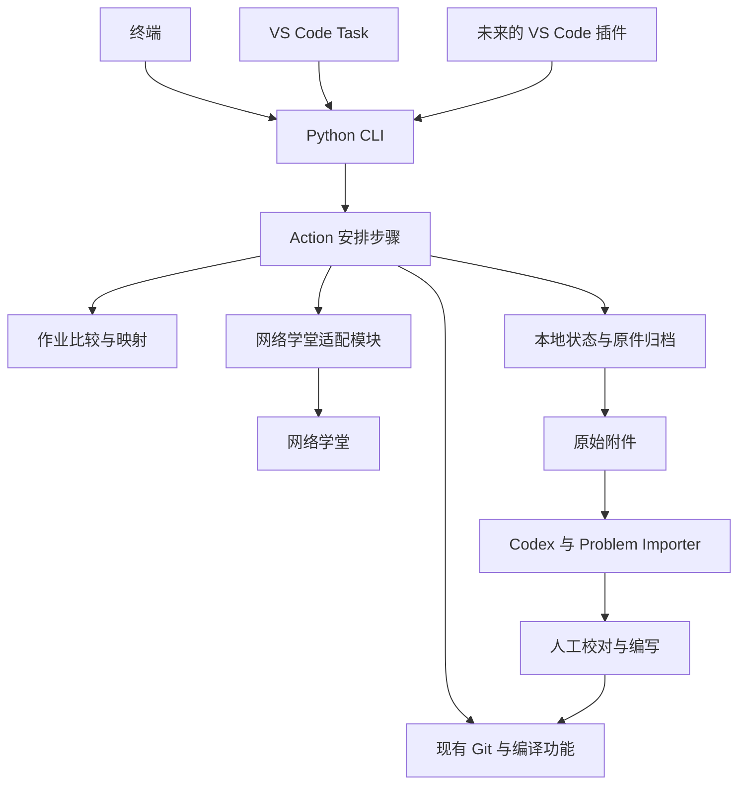

# Homework 自动化实践学习计划

本计划由用户与 AI 讨论，并由 AI 辅助整理。最近核对日期：2026 年 11 月 20 日。它持续记录整体方向、实际进度和当前任务，每完成一步同步更新，再根据结果决定后续安排。

## 计划的使用与更新

- 每次确定或执行“下一步”前，先核对“当前进度”、所属阶段和文末“当前下一步”，再按需读取相关代码与测试。恢复上下文时也从这里核对。
- 完成一个小任务后，在同一轮更新完成状态、验证依据、剩余问题和下一步。实现存在但未验证、仅有临时检查、已经有持久化测试，应分别说明。
- 文档用于表达目标与决定，实际代码和测试用于核验实现。发现不一致时先查明原因，再修正文档或实现；不能仅靠测试通过判断方向正确。
- 用户的新要求和仓库安全规则继续适用。重要范围或架构调整先说明取舍；候选方案不能直接记成已经确定的决定。
- 概念问答不必逐次记日志。主线进度改变或形成重要决定时才更新，保持一份计划即可。

## 项目目标与协作方式

本项目同时服务于两个目标。一方面，让计算机承担重复、规则明确的作业管理操作。另一方面，通过实际开发学习 Python、测试、调试和工程判断。

- 本地确定性程序负责获取数据、识别变化、归档文件、维护映射、检查状态，以及执行已经授权的操作。
- Codex 负责题目转录、公式与图形处理、必要的翻译、知识问答、只读检查，以及辅助设计和审查代码。
- 用户负责作业内容的编写与校对、课程和作业对应关系的确认，以及远程 Git、文件覆盖和正式提交等操作的授权。
- 简单功能优先由用户设计和实现。AI 先审查、解释和提示，修改方案保持在用户能够理解的范围内。
- 每个小阶段重点学习一两个概念，使用与风险相称的测试验收。已经掌握的重复操作交给工具执行。

## 当前进度

| 阶段 | 状态 | 已有结果或下一步 |
|---|---|---|
| 0. 学习当前已有代码 | 当前阅读目标已完成 | 已理解入口、公共模块和部分 Action，其余 Action 按需要补读 |
| 1. 本地调用 | 已完成 | VS Code 的 Homework Status Task 与终端输出一致 |
| 2. 离线识别与映射 | 进行中 | 2.6 Action 执行逻辑的 4 项新增测试通过；待把覆盖提示移入预览，再开放入口 |
| 3. 网络学堂只读读取 | 待开展 | 验证平台访问方式和一个真实课程的读取 |
| 4. 附件归档 | 待开展 | 先用本地假文件验证，再接入实际下载 |
| 5. 初始化与转录整合 | 待开展 | 对接现有 Manager 和 Problem Importer |
| 6. 辅助提交 | 待开展 | 准备 PDF、人工提交和核验服务端状态 |

已有新增实现与配置如下。

- [VS Code Task](/Users/chenghaoyi/Homework/.vscode/tasks.json)
- [数据处理与类型约定](.agents/skills/homework-manager/scripts/assignment_data.py)：比较、课程映射、绑定索引和新增绑定。
- [JSON 存储](.agents/skills/homework-manager/scripts/assignment_storage.py)：读取快照、课程映射、绑定，通过临时文件替换保存绑定，以及复制到固定 `.bak` 文件。
- [比较 Action](.agents/skills/homework-manager/scripts/actions/compare_assignments.py)：`CompareAssignments --previous ... --current ... [--course-mapping ...] [--bindings ...]`，只读显示新增、更新、默认课程和具体绑定；默认课程差异仅提示。
- [数据处理测试](.agents/skills/homework-manager/tests/test_assignment_data.py)、[存储测试](.agents/skills/homework-manager/tests/test_assignment_storage.py)、[CLI 与管理行为测试](.agents/skills/homework-manager/tests/test_homework.py)。

最近完整验证（Action 修改前的基线）：2026-11-20，共 87 项持久化测试通过，退出码 `0`。用户随后接入 Action 保存逻辑并修复操作展示；本轮新增并定向运行 4 项 Action 执行测试，全部通过，退出码 `0`。当前共 91 项测试，未重新运行完整测试；旧预览测试禁止 `add --apply` 的断言仍待入口开放时调整。覆盖提示尚未进入预览，整个 2.6 仍未完成。所有测试的文件与 Git 修改均位于临时目录和隔离仓库。

```sh
python3 -B -m unittest discover -s .agents/skills/homework-manager/tests -v
```

已有覆盖包括比较及重复身份、课程映射与输入保持、绑定唯一性与重复添加、文件读取异常、安全保存及失败时保留原记录，以及课程映射和绑定 CLI 的显示、顺序、只读性、差异提示和错误处理。人工确认绑定的写入 CLI、离线整流程演练及真实平台访问尚未完成。

## 整体架构

以现有 Python CLI 为共同入口，终端、VS Code Task 和未来的轻量插件调用同一套规则与操作。



| 部分 | 职责与接口方向 |
|---|---|
| CLI 与 Action | 解析参数、安排步骤、展示结果，执行前核对目标和授权 |
| 作业数据处理 | 接收普通 Python 数据，返回比较结果和映射判断，便于独立测试 |
| 网络学堂适配 | 封装选定客户端，将平台字段、分页和会话行为转换为内部约定 |
| 本地存储 | 保存完整快照、平台与本地作业的绑定、原件及归档记录 |
| 现有 Manager | 复用课程和作业初始化、Git 检查、同步、合并及编译功能 |
| Codex 转录 | 根据明确的原件、目标文件和题目范围执行现有 Importer 流程 |

新增模块围绕已经出现的职责逐步组织。优先使用普通函数、字典、列表、JSON 和现有工具。

## 阶段 0 · 学习当前已有代码

用 AI 辅助理解此前由 AI 编写的实现，沿着一次命令追踪参数、函数调用、结果和失败路径。已阅读的主线包括 `homework.py`、`common.py`、`Status`、`NewHomework`、`Compile` 和 `Sync`。其余 Action 在实际需要时补读。

学习方式以自己预测、源码核对和小范围验证为主。能解释操作在哪里发生、错误如何传回入口，以及失败后留下什么状态，即可继续开发。

## 阶段 1 · 本地调用

**实际问题**　日常状态查询需要一个便捷入口，使已经确定的命令可以直接运行。

**技术方案**　配置 VS Code 的 `process` Task，指定 Python 程序、参数数组和仓库工作目录，调用现有 `Status`。

**用户实践**　亲自编写 Task，对照终端运行结果核对配置。此步骤已经完成。

**重点知识**　可执行程序与参数的关系、工作目录及退出码。

**验收与风险**　Task 和终端指向同一仓库，显示一致的分支和工作区状态，正常结束并可重复调用。新增 Task 时继续明确工作目录和具体命令。

## 阶段 2 · 离线识别、JSON 快照与本地映射

**实际问题**　程序需要识别同一份平台作业的新增和更新，并记住它对应哪份本地作业。

**技术方案**

- 用 `(course_id, assignment_id)` 识别平台作业，初期记录包含 `title` 和 `due_at`，时间先使用统一格式的字符串。
- `compare_assignments(previous, current)` 返回 `(new, updated)`，两个列表保存当前快照的完整记录，并保持当前顺序。
- 相同身份的标题或截止时间变化时归入更新。任意一份输入中出现重复身份时抛出 `ValueError`。
- 将列表输入接到 JSON 文件读取，先用手写的旧、新快照练习，再加入课程和作业绑定。
- 课程映射提供未绑定作业的默认课程建议；具体作业绑定保存经人工确认的完整本地位置。已有作业绑定优先，标题、截止时间或默认课程变化不自动改写它，详见下文“绑定语义与处理顺序”。
- 本地状态初期采用 JSON，放在仓库外的可配置数据目录，便于跨作业分支使用和备份。

**用户实践**　用户已实现比较、映射、绑定和 JSON 读写的主要逻辑，以及比较、课程映射和只读绑定查询 CLI。AI 负责审查、按请求补充部分测试和类型标注。接下来讨论人工确认后落盘的最小流程，再由用户尝试适合当前水平的实现；已掌握的重复性测试工作可交给 AI。

**重点知识**　已经练习 JSON、异常、临时文件、稳定身份查询和测试。下一步聚焦预览与执行的边界、重复执行与数据保存。类型标注整理已暂时收尾。

### 阶段 2 的小任务与边界

| 小任务 | 状态 | 结果与验收 |
|---|---|---|
| 2.1 离线比较与课程映射 | 已完成 | 普通字典与列表输入；区分新增、更新、已映射和未映射；不修改输入 |
| 2.2 读取 JSON | 已完成，读取回归已修复 | 身份校验已移到字段与类型检查之后，当前 37 项存储测试通过 |
| 2.3 绑定处理与保存函数 | 已完成 | 双向唯一性、重复添加不重复记录、冲突拒绝；保存前校验，失败保留原记录 |
| 2.4 比较与课程映射 CLI | 已完成 | 新旧快照与可选课程映射接入；显示身份、标题、截止时间和本地课程；顺序与原件保持 |
| 2.5 只读绑定查询 CLI | 已完成 | 绑定展示、顺序、输入保持、默认课程差异提示、错误处理与只读约束通过持久化测试，已更新 Skill 文档 |
| 2.6 人工确认绑定并落盘 | Action 执行测试通过，CLI 待开放 | 操作与备份路径展示已修复；保存、重复执行、失败及重新读取共 4 项新增测试通过，覆盖提示待移入预览，入口仍拒绝 `--apply` |
| 2.7 离线流程验收 | 待开展 | 从模拟快照到查询、人工绑定、保存与重读；重复运行一致；快照缺项不删除旧绑定 |

2.6 开始前再确定入口与预览/执行方式，不提前增加 Action、状态目录或通用工作流框架。当前所有数据文件通过路径参数指定；实际状态按原设计保存在仓库外，默认目录及配置方式尚未实现。

### 已确定的接口选择

- 平台身份使用 `(course_id, assignment_id)`；本地位置使用 `(local_course, local_number)`，标题和截止时间不参与身份判断。
- 数据结构的字段约定集中在 `assignment_data.py`，存储校验放在 `assignment_storage.py`，Action 安排步骤与展示结果。
- `TypedDict` 说明已有字典记录，保留普通字典及运行时校验。新增公共接口优先标注；只读输入可用 `Sequence`、`Mapping`，返回类型说明实际容器。旧模块暂不批量补标注，不引入复杂泛型或新的检查框架。
- CLI 不传可选参数时保持已有输出；错误写入 `stderr`，非零退出。只读查询不自动创建、保存或修复绑定。
- `save_bindings` 是底层保存函数，调用方必须先取得相应写入授权；临时文件替换不能替代备份，也不代表支持并发写入或保证断电恢复。现阶段按单进程、串行的模拟流程验收。

### 绑定语义与处理顺序

本节于 2026-11-20 根据用户要求、由 AI 辅助明确，作为后续实现和验收依据。它替代此前“默认课程与绑定课程不同就终止只读查询”的规则；查询与差异提示已在 2.5 接通并验收，确认与保存的编排仍待 2.6 实现。

| 数据 | 含义 | 权限与用途 |
|---|---|---|
| `course_mapping[course_id] = local_course` | 为尚未绑定的作业提供默认课程建议 | 不确定具体编号，不自动创建作业，也不修改已有绑定 |
| `bindings` 中的 `(course_id, assignment_id) → (local_course, local_number)` | 这项作业经人工确认的完整本地位置 | 已绑定作业的目标依据；保留自身的 `local_course`，不从当前默认值重新推导 |
| `MappedAssignment` | 根据默认映射补充了候选课程的临时记录 | 尚不表示人工确认，也不表示已经创建本地作业 |
| `binding_index` | 根据绑定列表生成的内存查询字典 | 用于查询与唯一性检查，不是第三份持久化关系 |

**查询与目标准备**

1. 加载绑定记录后，先按 `(course_id, assignment_id)` 查询已有绑定。有绑定就使用其完整目标，不用默认课程替换它。
2. 确认未绑定后，才用课程映射建议课程。没有课程映射则等待用户选择；有默认课程仍然不能推导本地作业编号。
3. 未提供 `--bindings` 只表示本次没有查询绑定，不能据此断言作业尚未绑定。后续写入前必须读取实际要更新的绑定文件。
4. 标题、截止时间或默认课程变化，以及一次快照缺项，都不自动更新或删除已有绑定。不按标题相似度重新绑定。

**默认课程与已有绑定不同**

- 这表示默认建议与已确认位置有差异，不等同于绑定记录无效。只读查询继续展示，目标以具体作业绑定为准。
- 在同时提供两份数据且本次显示记录确有差异时，向 `stderr` 输出 `WARNING:` 提示，包含平台两个 ID、默认课程和已绑定课程；正常结果写入 `stdout`，仅此差异不改变成功退出码 `0`。
- 默认映射缺少课程键、未提供其中一个来源，或差异只涉及未显示的作业时，不产生这项提示。不得自动修改任意来源。
- 保留现有 `Local course` 标签，明确它展示课程映射中的默认建议；`Local assignment` 展示具体绑定目标。两行可不同，差异用上述提示解释。

例如默认课程为 `Analysis-1`，已有绑定为 `Algebra-1/7` 时，继续显示这两个值并提示差异；查询和后续针对既有作业的操作使用 `Algebra-1/7`。显示绑定不代表已经验证本地目录或 PDF 存在，执行实际操作前仍由对应管理流程检查。

**确认与保存**

1. 写入 Action 加载实际绑定存储，先查已有关系。相同关系重复确认时保持原样；试图给已有平台身份换目标，或占用已被其他作业绑定的本地目标时，拒绝自动修改。
2. 对未绑定作业，用默认课程准备建议，允许用户明确选择其他课程。展示最终的平台身份、课程、编号及数据文件，取得确认后再执行。默认值不是写入授权。
3. 阶段 2.6 只处理人工确认的现有本地作业对应关系，并检查目标。实际新建目录和分支留到阶段 5，复用 `NewHomework`，核验创建结果与确认目标一致后再登记绑定。
4. 确认后调用 `add_assignment_binding` 生成新列表，再调用 `save_bindings` 保存整份列表，保留其他记录。不能用当前快照重建并覆盖绑定列表，也不能把新默认值套到旧绑定上后强行保存。
5. 真正的数据错误仍报错：无效 JSON、错误字段、重复平台身份或重复本地目标等。原文件不自动修复。首次建立绑定文件的显式流程在 2.6 再确定，缺失文件不能默认为已有空记录。
6. 当前不提供改绑或迁移功能；将来确有需求时单独设计授权、目标核验和恢复方式。

**实现职责**

- Action 安排读取、先查绑定、查询默认建议、展示和确认的顺序；2.5 只读 Action 不调用保存函数。
- `assignment_data.py` 保留纯数据规则：课程映射、建立索引、绑定唯一性和重复添加。只有规则出现多个调用位置或明显变复杂时，再提取共同的目标解析函数。
- `assignment_storage.py` 负责单份文件的读取、字段校验和保存，不替用户选择目标，也不隐式读取另一份文件决定优先级。
- 本节是已确定的行为规范，不能仅凭现有类型定义或某个函数存在就认定整条流程已实现。

**验收与风险**

- [x] 比较函数识别新增和更新，并检查两份列表内的重复身份。
- [x] 从两份 JSON 快照读取列表并比较，通过 CLI 显示结果。
- [x] 身份校验放在字段与类型检查之后，文件缺失、JSON 格式错误和数据结构错误的既有处理通过存储测试；快照重复身份由共享函数检查。
- [x] 课程映射读取及 CLI 显示，未映射记录不丢失，数量和顺序保持。
- [x] 函数层验证绑定双向唯一性、重复添加、标题或截止时间变化后绑定保持。
- [x] 保存前校验，通过临时文件替换正式文件，测试写入和替换失败时保留原记录。
- [x] 绑定查询 CLI 遵循已有绑定优先，课程映射差异仅提示，有对应的持久化测试。
- [ ] 人工确认一项绑定并保存、重读的实际调用流程，有与副作用相称的检查。
- [ ] 模拟快照缺项后核对旧绑定仍完整保留，不根据一次缺项自动删除绑定。
- [ ] 完成 2.7 演练，审查本阶段需求是否满足，再决定进入阶段 3。

真实平台接入时还需要核实两个 ID 的作用范围、学期区分和截止时间格式。当前只比较时间字符串，不能据此判断时区、逾期或平台数据完整性。阶段 2 不要求提前解决平台登录、下载、GUI 或提交。

## 阶段 3 · 网络学堂只读读取

**实际问题**　将人工准备的列表替换为真实平台数据，减少手动发现新作业和截止时间变化的工作。

**技术方案**　先核实平台允许的访问方式，在独立适配模块中封装选定客户端。先读取一个学期的一门课程，将结果转换成阶段 2 使用的记录格式，再验证分页和列表完整性。

已有公开资料初查涉及以下项目。选型时重新核对维护状态、许可证、认证方式、依赖和真实兼容性。

- [learn2018-autodown](https://github.com/Trinkle23897/learn2018-autodown)
- [thulearn2018](https://github.com/euxcet/thulearn2018)
- [learnX](https://github.com/robertying/learnX)
- [learnX 使用的独立 thu-learn-lib 分支](https://github.com/robertying/thu-learn-lib)

**用户实践**　使用脱敏响应样本实现字段转换，核对平台页面与程序结果。AI 协助调查客户端、认证和网络失败行为。

**重点知识**　HTTP 响应、身份认证与会话失效，以及模块接口。

**验收与风险**

- 官方网页与程序读取的课程、作业、截止时间和附件描述逐项对应。
- 覆盖分页、字段缺失、超时和会话过期，读取失败时保留上一次完整快照。
- 原始账号凭据、Cookie 和令牌仅在明确授权的本地认证流程中处理，妥善存放并控制日志内容。
- 对外传给比较模块的数据使用内部格式，使平台变化集中在适配模块中处理。

## 阶段 4 · 附件下载与原件归档

**实际问题**　完整保存原始题目及其更新版本，并在下载中断后能够继续处理。被 Git 忽略的 PDF 需要独立的恢复途径。

**技术方案**　原件首先归档到仓库外，记录平台身份、附件来源、原始文件名和内容哈希。相同内容复用，同名新版独立保存。下载先写临时文件，验证成功后进入正式归档。

**用户实践**　先用本地假文件完成命名、哈希比较和归档记录，再接入网络下载。

**重点知识**　`pathlib`、文件哈希、临时文件与中断恢复。

**验收与风险**

- 覆盖中断、重复下载、同名不同内容、异常文件名和路径越界。
- 验证下载结果确为预期附件，识别会话过期返回的登录页等异常内容。
- 分别记录附件已被发现和已完整归档的事实，未完成项在下次运行时继续处理。
- 归档和映射纳入备份，并实际恢复一份文件验证恢复流程。
- 将所需原件复制到作业目录时遵循现有 Skill 的保留与冲突处理规则，并核对暂存范围。

## 阶段 5 · 初始化与题目转录整合

**实际问题**　把平台作业准确关联到本地分支、目录和转录目标，处理初始化中途失败与重复执行。

**技术方案**　准备包含平台作业、课程、编号、分支和远程动作的初始化计划。人工确认后调用现有 `NewHomework`，核对实际创建结果后更新绑定与进度。随后准备原件和目标 `.tex`，使用现有 Problem Importer。

**用户实践**　实现待确认摘要，使用隔离仓库和一份历史作业验证整条流程，并对照原件校对转录结果。

**重点知识**　多步骤操作的失败状态、重试与结果核验。

**验收与风险**

- 修复更新 `main` 后重新计算编号可能偏离预览目标的问题。执行前核对确认过的目标，变化时返回新的计划。
- 在隔离仓库验证目录或分支已存在、推送失败和重复执行，避免重复初始化或错误绑定。
- 本地创建与远程推送的进度根据实际结果记录，失败后能够检查并继续处理同一作业。
- 原件完整保留，转录后的公式、语言、题目顺序和图形由用户对照检查。
- 编译验证通过后检查相关页面的布局，结合原件确认内容。
- 若扩展合并与清理操作，核对分支 tip 的包含关系和远程清理目标。对同一仓库的自动写操作进行串行控制。

转录初期通过现有 Skill 交接。出现稳定的批处理需求时，再评估官方模型调用方式的必要性、可靠性和复杂度。

## 阶段 6 · 辅助提交

**实际问题**　确认待提交 PDF 对应正确作业，并取得服务端实际提交状态。

**技术方案**　复用 `Compile`，准备包含目标平台作业、截止时间和 PDF 的提交前摘要。初期由用户在官方网页提交，再核对服务端记录。提交接口的集成在平台要求和技术可行性明确后单独评估。

**用户实践**　编写提交前检查与摘要，学习如何选择可验证的完成依据。

**重点知识**　产物有效性、目标匹配，以及本地状态与服务端状态的关系。

**验收与风险**

- 测试 PDF 缺失、编译失败、产物过期和错误映射。
- 编译结果、Git 同步情况和平台提交状态分别根据实际证据更新。
- 正式提交前明确授权，提交结果通过对应作业的服务端记录核对。
- 上传中断或结果不明确时，先查服务端状态，再决定后续处理。

## 未来的轻量 VS Code 插件接口

插件先提供刷新和展示，再按实际需要逐项接入写操作。

- 以现有 CLI 作为进程接口。TypeScript 收集选择并展示结果，Python 执行规则和文件、Git 操作。
- 第一条机器接口拟为 `Status --json`。届时提取状态收集逻辑，让文本展示和 JSON 展示使用同一份数据。
- JSON 带 `schema_version`。成功结果写入标准输出，诊断写入标准错误，失败返回非零退出码。`next_number` 作为显示提示，创建时重新校验。
- 插件集中解析 JSON，检查返回结构和接口版本。测试中文与空格路径、进程启动失败和非零退出码。
- 从受信任的工作区调用选定仓库入口，通过 `spawn` 的参数数组启动，并明确工作目录。
- 接入写操作时，CLI 提供结构化计划，插件展示并收集确认，Python 执行前复核目标与状态。

## 当前下一步

**任务：2.6 人工确认绑定并落盘。状态：Action 执行逻辑已有隔离测试；覆盖提示待移入预览，CLI 尚未开放。**

**已完成的小任务**　按用户请求，由 AI 实现 `backup_bindings(path: Union[str, Path]) -> Path`：将原文件复制到同目录的固定 `.bak` 路径并返回它，不解析 JSON、不修改原文件。重复备份覆盖同一文件，复制异常直接向上传递；5 项新增测试仅使用临时文件。

**下一小步**　用户将“已有备份将被覆盖”的提示放到新增绑定的预览展示中，成功提示简化为保存成功。无需为两次相等比较重构，也不新增状态类或确认机制。随后由 AI 开放入口的 `BindAssignment --apply`，调整旧断言、补 CLI 执行与失败测试、同步 Skill 并运行完整测试；验证通过后再标记 2.6 完成。

**本轮审查与验证**　操作和备份路径已经在预览前展示，备份与保存留在执行分支。两次比较分别服务于展示与执行，可以保留；仍需把覆盖提示从保存成功后移到预览前。AI 新增 4 项直接调用 Action 的隔离测试，验证保存及覆盖旧备份、重复执行不调用写入函数、备份失败阻止保存、保存失败保留备份，以及预览后重新执行读取最新绑定，全部通过。未修改用户 Action 或开放入口。

**备份策略与函数约定（2026-11-20 按用户偏好简化）**

- 备份不是所有更新都必须具备的通用规范。本项目保留一个上版本作为简单回退，替代此前多版本备份方案，不实现唯一后缀、历史轮换或自动清理。
- 使用原文件同目录下的固定路径：`bindings.json` 对应 `bindings.json.bak`，即原文件名加 `.bak`。它是本工具保留的备份位置，重复调用允许覆盖该备份，不覆盖其他文件；返回值始终是这个备份路径。
- 备份内容与调用时的原文件逐字节一致，原文件不变。可直接复用标准库文件复制操作，不为备份另建一套临时文件替换或自动回滚机制；现有 `save_bindings` 的临时文件保存方式保持不变。
- Action 只在用户明确执行且确有新增时，先把更新前的原文件复制到备份，再保存新内容。不能在更新后复制新内容作为旧版本备份。预览或已有相同绑定时不调用备份。
- 备份失败时传播异常，Action 不继续保存，原绑定文件仍保留；不承诺失败的备份写入还能保留更早的旧备份。只保留一版意味着较早的误操作可能无法通过它恢复，这是当前接受的取舍。
- 不自动恢复或删除任何备份。后续接入执行时，预览应明确显示固定备份路径及覆盖这份备份的行为。
- 函数使用一句话 docstring，备份函数已完成并测试；接通 Action 前，入口继续拒绝 `BindAssignment --apply`。
- AI 已补 5 项临时目录测试，覆盖字节一致、字符串与 Path 路径、重复覆盖、原件保持、缺失原件、复制失败，以及从备份实际恢复旧绑定。下一步接入“重新读取、核对变化、备份、保存”。

**目的与学习重点**　把已经验证的新增绑定与保存函数组合起来，让一项经确认的对应关系能够安全落盘；学习预览、授权、执行前复核与重复执行。

**已确定的范围**

1. 一次只确认一项平台作业到一份现有本地作业的绑定，不创建作业目录、分支或提交文件。
2. 复用 `load_bindings`、`add_assignment_binding`、`save_bindings`，遵守上文的绑定语义。课程映射只提供候选，最终课程和编号必须明确。
3. 默认只读预览，展示确切的平台身份、本地目标、保存文件及是否新增；只有明确授权的执行才保存。执行前重新读取并核对状态，不使用预览时保留的整份旧列表覆盖后续变化。
4. 相同关系重复执行不产生重复记录；改绑或占用其他作业目标时拒绝自动修改。数据或保存错误不能报告成功，其他绑定保留。
5. 首次建立绑定文件、备份与恢复方式需要在开始写入前明确，不能把意外缺失的文件默认为空存储。

**保存前尚需明确的事项**

- 已采用独立的 `BindAssignment` 及以下显式参数，平台选择和现有目标的预览检查已经实现；不再重选这部分接口。
- 保存时如何重新读取最新绑定并复核目标、仅在确有新增时调用备份、备份或保存失败怎样报告实际状态；预览明确固定备份路径及其覆盖行为。
- 首版仍由用户显式准备 `[]` 绑定文件，缺失时继续报错；恢复备份必须核对具体文件和授权，暂不增加初始化或迁移命令。

备份函数与 Action 执行逻辑已通过对应测试；覆盖提示与 CLI 集成尚未完成，不提前启用 `--apply` 或自动恢复。

**已验收的预览接口（保存尚未实现）**

```sh
python3 .agents/skills/homework-manager/scripts/homework.py BindAssignment \
  --current snapshot.json \
  --course-id course_1 --assignment-id hw_1 \
  --course Algebra-1 --number 7 \
  --bindings /path/to/bindings.json
```

- 单独使用 `BindAssignment`；`--current` 指定平台快照，两个平台 ID 选择其中一项，`--course`、`--number` 明确最终本地目标，`--bindings` 指向已有存储。首版不从默认课程自动确定写入目标。
- 默认只读预览：显示平台两个 ID 与题目标题、本地作业的完整路径、绑定文件及拟新增或已有相同关系；缺项、目标不明确或绑定冲突时报告错误。
- 预览前核对平台记录选择唯一、目标课程和数字作业目录及同名 `.tex` 存在、绑定文件有效。读取与检查不改正文，不要求编译 PDF。
- 首版由用户先在仓库外显式准备 `[]` 存储；文件缺失仍报错，不增加初始化命令。
- 后续明确 `--apply` 执行：重新读取与校验；只有确有新增时才先将旧内容复制到固定 `.bak` 文件，覆盖上次备份，再保存新内容；备份失败不执行保存，相同关系不重复保存或备份。恢复操作在接入保存前明确。
- 只读预览已验收，传入 `--apply` 在入口明确拒绝；待备份和保存流程通过验证后，才更新这项限制和使用文档。

**实现后的验收方向**　在临时目录和隔离仓库检查预览无写入、确认后仅新增目标绑定、重复执行、目标或数据变化、冲突拒绝、缺失或错误存储、保存失败及恢复。具体测试随接口确定，不先为未出现的机制写测试。

**最近记录：2026-11-20**　用户接通 Action 保存并修复操作与备份路径展示；AI 补充 4 项执行测试，定向全部通过，退出码 `0`，同步更新计划。覆盖提示尚需放到预览中；本轮未改用户 Action、未开放 CLI、未执行真实仓库的 Git 写操作。

**本阶段暂缓**　扩大类型体系、批量重构旧 Action、完整 GUI、插件开发、真实账号访问、附件下载、自动初始化与提交。阶段 3–6 保留上述路线，具体客户端、接口和依赖在进入对应小任务时重新核实。
