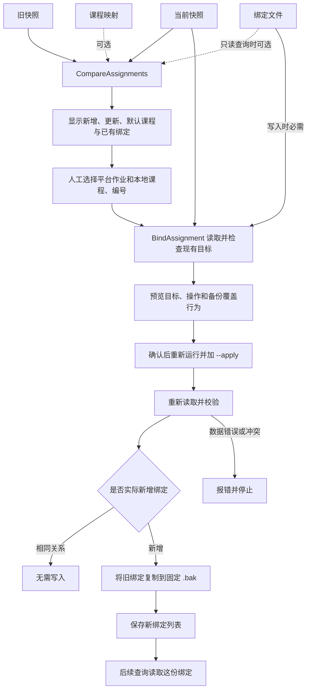
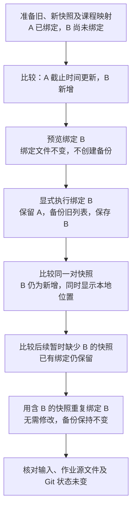
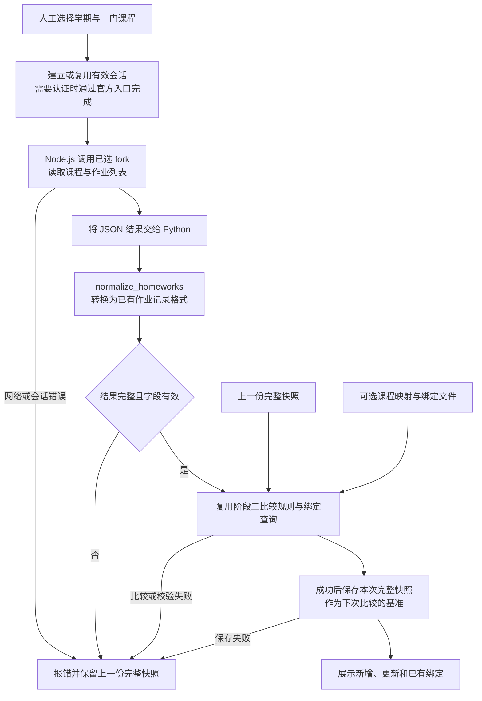

# Homework Manager：业务逻辑与 CLI 手册

Homework Manager 提供本地作业管理命令：查询仓库、创建课程和作业、编译、同步与完成作业，以及比较离线作业快照、登记平台作业与本地作业的对应关系。

程序位于 `tools/homework/`，可直接从终端、VS Code Task 或未来插件调用；Skill 只指导 AI 如何使用同一个 CLI。程序、测试和依赖均在本目录维护。

本文由 AI 辅助编写，已有行为依据当前源码说明，待开发流程明确标为规划。仓库规则见 [AGENTS.md](../../AGENTS.md)，Codex 操作约束见 [SKILL.md](../../.agents/skills/homework-manager/SKILL.md)，开发路线与进度见 [AUTOMATION_PLAN.md](../../AUTOMATION_PLAN.md)。

## 1. 运行入口

需要 Python 3.9 或更新版本和 Git；编译需要 MacTeX 中的 `latexmk`、XeLaTeX；`Open` 使用 macOS 应用。管理脚本只使用 Python 标准库，无需安装第三方 Python 包。目标仓库需要已有本地 `main` 分支；Git 同步操作需要配置 `origin`。

以下命令假定终端位于 Homework 仓库根目录：

```sh
python3 tools/homework/scripts/homework.py --help
python3 tools/homework/scripts/homework.py Status
```

统一格式为 `python3 .../homework.py <Action> [options]`，Action 名区分大小写。始终调用这个入口，不直接运行 `scripts/actions/` 下的文件。

- 默认仓库根目录根据脚本位置确定，不依赖终端工作目录；在其他目录调用时需要写出脚本的正确路径。
- `--repo-path <path>` 用于隔离测试或显式选择另一份 checkout，不会切换终端工作目录。
- 快照、课程映射和绑定文件的相对路径，均相对于终端工作目录解析。
- 含空格的参数用引号包围，例如 `--bindings "/path/with spaces/bindings.json"`。
- `--help` 展示统一参数列表；各 Action 适用的参数以本文对应条目为准。

## 2. 业务流程

### 2.1 日常作业管理

```text
Status 查询
→ NewHomework 创建作业分支、目录和模板
→ 录入题目、人工编写作业
→ Compile 编译并检查 PDF
→ Sync 提交并推送当前作业
→ Finish 合并到 main、推送并清理作业分支
```

新课程先通过 `NewCourse` 创建。`NewHomework` 生成作业骨架，题目转录由现有 [Problem Importer Skill](../../.agents/skills/homework-problem-importer/SKILL.md) 配合 Codex 处理；管理命令不负责解题。编译成功只表示编译器完成工作，数学内容仍需检查。

作业位于 `<course>/<number>/<number>.tex`，分支名为 `<course>-HW<number>`。新作业复制根目录当前版本的 `homework.sty`，保留旧作业中的历史副本。同名编译 PDF 可追踪，其他题目和图形 PDF 保持本地、被 Git 忽略；原件不能只依靠 Git 恢复。

### 2.2 阶段二总流程：离线作业识别与绑定（已实现）

快照记录观察到的作业信息，课程映射提供默认建议，作业绑定保存人工确认的本地位置。典型调用过程如下；每个命令独立执行，预览后需要重新运行并加 `--apply`，不会等待交互式确认。



**比较规则**

- 用 `(course_id, assignment_id)` 识别平台作业，不根据标题匹配。身份在每份快照内必须唯一。
- 当前存在、旧快照不存在：新增。身份相同但 `title` 或 `due_at` 变化：更新。
- 信息相同的作业不显示；只在旧快照中出现的记录不产生删除操作。新增和更新各自保持当前快照中的顺序。
- 截止时间目前按字符串比较，不计算时区、逾期或剩余时间。
- 比较命令不写文件，也不会自动把 `current` 保存成下一次的 `previous`。

**课程建议与具体绑定**

| 数据 | 含义 | 例子 |
|---|---|---|
| 课程映射 | 平台课程对应的默认本地课程，不包含作业编号 | `course_42 → Algebra-1` |
| 作业绑定 | 经确认的平台作业对应的完整本地位置 | `(course_42, hw_7) → (Algebra-1, 9)` |

已有作业绑定是确认目标的依据。标题、截止时间、默认课程变化或一次快照缺项，都不会自动改写或删除绑定。平台 ID 与本地编号不必相同。

`CompareAssignments` 的展示含义：

| 输出 | 含义 |
|---|---|
| `Local course: ...` | 课程映射的默认建议 |
| `Local course: (unmapped)` | 提供了映射文件，但没有该课程的条目 |
| `Local assignment: ...` | 已确认的具体绑定 |
| `Local assignment: (unbound)` | 提供了绑定文件，但没有该项作业的绑定 |

未提供对应文件时，省略对应行，表示本次未查询该来源。如果默认课程与已有绑定不同，仅对本次显示的受影响记录向 `stderr` 输出 `WARNING:`，继续展示，退出码仍为 `0`。

“新增”和“未绑定”是独立概念：绑定 B 后，继续比较同一对快照，B 仍属于新增，只是现在会显示它的本地位置。

**确认和保存**

`BindAssignment` 根据当前快照中的两个平台 ID 选择作业，目标课程和编号必须显式提供。它不读取课程映射替你选择目标，也不创建作业目录；目标目录及同名 `.tex` 必须已存在。

- 已有完全相同的绑定：无需修改，不备份、不保存。
- 同一平台作业已绑定到其他位置，或目标已被其他平台作业占用：报错，不自动改绑。
- 新增关系：保留其他记录，预览展示目标和备份覆盖行为；加 `--apply` 后重新读取校验，先备份旧文件，再保存新列表。

备份固定为原文件名加 `.bak`，例如 `bindings.json.bak`，每次覆盖上一次备份，只保留上一版。备份失败停止保存；保存使用同目录临时文件替换目标，失败会报错，已完成的备份保留。没有自动恢复、历史轮换或并发写入协调机制。

### 2.3 阶段二验收流程：2.7 串联场景（已通过）

这一图记录验收场景，不增加新的生产功能。现有 `test_offline_assignment_workflow` 通过真实 CLI 串联两个 Action，在临时目录和隔离仓库中检查结果。



该场景说明：快照描述平台信息，绑定描述已确认的对应关系。两者独立保存；平台记录一次缺项，不构成删除本地绑定的依据。

### 2.4 阶段三规划：网络学堂只读读取（尚未接通）

阶段三把模拟数据换成网络学堂返回的数据，再复用阶段二规则。已完成公开客户端调查，用户已选择 [robertying/thu-learn-lib](https://github.com/robertying/thu-learn-lib)；字段转换和模拟 Node/Python 通信已通过离线测试，固定版本客户端已安装并通过本地加载检查。真实读取脚本、认证与快照保存尚未接通。以下是目标流程，当前 CLI 尚不能执行这条完整链路。



**分步开发与学习安排**

| 小步 | 工作与验证目标 | 分工与重点 |
|---|---|---|
| 3.1 调查客户端（已完成） | 核对许可证、认证与读取接口，选择 fork | AI 调查，用户判断取舍 |
| 3.2 字段转换（已完成） | `normalize_homeworks` 的 5 项离线测试验证字段映射、顺序、输入保持和重复身份 | 用户写 Python，AI 审查并补测试；学习外部格式与内部格式的边界 |
| 3.3 最小进程通信（模拟链路与依赖准备已完成） | 模拟通信已测试，固定版本客户端可本地加载；正式读取脚本待实现 | AI 主导 Node 部分；学习进程输入输出、退出码及依赖管理 |
| 3.4 一门真实课程验证 | 明确人工认证方式，核对学期、课程、各提交状态下的作业、身份字段和截止时间 | 用户在官方网页核对；AI 协助会话与 HTTP 问题 |
| 3.5 快照与现有流程衔接 | 完整读取、校验、比较后保存快照；失败保留上次完整结果 | 复用已有数据规则；具体 CLI、保存方式和首次基准初始化在这一步明确 |
| 3.6 阶段验收 | 模拟网络失败、会话过期与部分列表失败，核对错误不会被当成空列表；人工核对真实结果 | 自动测试复用 `unittest`，真实账号检查单独进行 |

**模块边界**

- Node 程序只负责调用现有客户端；Python 保留 CLI、字段转换、比较和存储。先使用短时子进程，不增加 HTTP 服务或常驻进程。
- 进程成功时以 JSON 传递数据，诊断日志与数据分开，日志不包含密码、Cookie 或令牌。有效会话可复用，具体认证、会话交接和存储方式在真实访问前明确，凭据不经过 AI 对话。
- Python 的转换入口先把 `baseId`、`title`、`deadline` 对应到 `assignment_id`、`title`、`due_at`，课程 ID 由调用上下文提供。`id` 与 `baseId` 含义不同；真实课程验证后确认身份及时间约定。
- 快照同步和绑定保存是独立流程。同步不修改 `bindings.json`，新作业的具体位置仍通过 `BindAssignment` 人工确认。

**保存与验收边界**

新快照必须对应明确的课程范围并完整读取。合法的空列表可以是正常结果；超时、会话失效或部分读取失败不能被吞掉后当作空列表保存。确认数据、比较和保存均成功后，才推进下一次比较的基准；失败时保留上一次完整快照。

图中的自动保存和基准推进是阶段三的规划，不是当前 `CompareAssignments` 的行为。阶段三先验证一门课程，之后再扩展范围；附件下载归入阶段四，作业初始化与转录衔接归入阶段五，平台辅助提交归入阶段六。

推进比较基准只表示已读取这次信息，不代表作业已绑定或已完成；推进后如何继续查询未绑定记录，在 3.5 接入实际 CLI 时明确。

**本地通信示例（AI 辅助实现）**

[learn_bridge.py](scripts/learn_bridge.py) 提供 `read_node_homeworks(course_id, script_path)`：启动 `node <script_path> <course_id>`，分别捕获 UTF-8 标准输出和标准错误，最多等待 30 秒。脚本成功时，标准输出必须仅含一个 JSON 列表，每条记录的 `baseId`、`title`、`deadline` 均为字符串；额外字段允许存在。Python 检查这些字段后复用 `normalize_homeworks`，重复身份仍由已有规则拒绝。

进程启动失败、超时、非零退出或无效输出均报错；不会变成成功的空列表。标准错误不混入 JSON，也不自动展示其可能包含的敏感内容。当前通信测试仅使用[假数据脚本](tests/fixtures/mock_learn.mjs)，该脚本不需要 npm 依赖，不访问网络、保存快照或新增 Action；这不证明真实平台列表完整或认证可用。

在仓库根目录运行以下示例，可以看到转换后的内部作业记录：

```sh
python3 -B - <<'PY'
import json
from pathlib import Path
import sys

program = Path("tools/homework")
sys.path.insert(0, str(program / "scripts"))
from learn_bridge import read_node_homeworks

assignments = read_node_homeworks("course_1", program / "tests/fixtures/mock_learn.mjs")
print(json.dumps(assignments, ensure_ascii=False, indent=2))
PY
```

**客户端依赖准备（AI 辅助配置）**

Node 部分集中在 [node/](node/)；现有 Python CLI 仍只使用标准库。根据[已核对版本的配置](https://github.com/robertying/thu-learn-lib/blob/0305ee55364546bc604c7af8bae183400956a952/package.json)，安装 `@robertying/thu-learn-lib@9.1.4`，运行要求为 Node >=22。

| 文件或目录 | 用途 |
|---|---|
| [package.json](node/package.json) | 直接依赖的固定版本、Node 要求和检查命令；`private` 防止误发布 |
| [package-lock.json](node/package-lock.json) | 固定实际解析出的依赖版本、下载位置及完整性摘要；与配置一同保留 |
| `node_modules/` | 下载的库及间接依赖；由局部 `.gitignore` 忽略，可按锁文件重建 |
| [check-client.mjs](node/check-client.mjs) | 导入客户端和 Cookie 配置，创建空会话对象，检查所需读取方法存在 |

在仓库根目录安装锁定依赖并运行检查：

```sh
npm --prefix tools/homework/node ci --ignore-scripts --no-audit --no-fund
npm --prefix tools/homework/node run check
```

[`npm ci`](https://docs.npmjs.com/cli/v11/commands/npm-ci/) 按锁文件重新安装依赖，会替换该项目的 `node_modules`；`--ignore-scripts` 禁用依赖安装脚本。首次锁文件由本项目的 `npm install` 生成，后续重建使用上述命令，无需全局安装客户端或另外安装 pnpm。

检查脚本不调用登录或课程接口，也不是交给 `read_node_homeworks` 的读取脚本：它输出检查结果文本，而桥接函数要求作业 JSON 列表。正式读取脚本将在会话输入方式明确后添加，现阶段仍用 `mock_learn.mjs` 验证通信。

**会话恢复：已验证库接口，真实接入待确认**

所选版本的[认证说明](https://github.com/robertying/thu-learn-lib/blob/0305ee55364546bc604c7af8bae183400956a952/README.md#logging-in)支持恢复 Cookie jar，并通过 `setCSRFToken` 恢复对应令牌。`ensureSession()` 会发送会话探测请求；没有凭据提供器时，会话过期直接失败。Cookie jar 不会自动继承浏览器状态，其序列化格式也不同于浏览器直接导出的 Cookie 文件。

AI 新增 [session.test.mjs](node/session.test.mjs)，用假 Cookie、假令牌和替换后的 `fetch` 验证：恢复后传递 Cookie/令牌、过期后停止且不尝试密码登录，以及缺少令牌时不能只凭 Cookie 恢复。这三项测试均通过，没有真实网络访问：

```sh
npm --prefix tools/homework/node test
```

首次验证建议由用户在官方网页手工登录，再在本机准备会话数据。具体导出步骤需根据浏览器核对，目前尚未实施。候选存储位置为仓库外的 `~/Library/Application Support/Homework/session.json`，仅当前用户可读写；Cookie 与令牌不进入代码、命令行参数、日志或 AI 对话。尚未创建真实会话文件或确定最终文件格式。失效后重新人工认证，当前不保存密码或接入自动密码重登。

正式读取脚本在浏览器会话交接方式明确后实现；首轮只核对用户选择的一门课程，失败不推进快照基准。Python 的 30 秒进程超时与客户端请求超时也将在这一步统一，避免合法请求尚未结束就被提前终止。

当前用户选择 Chrome，先核对“代数-1”。拟从 Chrome Network 的单条成功请求中读取 Cookie 值及解码后的 `_csrf` 查询参数，通过本地隐藏输入工具交接，再构造 Cookie jar；具体工具尚未实现。浏览器提供这些值不代表服务端已接受复用，仍需实际核对。“物理-1”待下载作业作为后续识别与附件归档案例保留。

## 3. JSON 数据约定

文件使用 UTF-8。以下 ID、日期和本地位置均为格式示例；文件名由调用方选择，没有隐式的默认数据目录。状态文件优先保存在仓库外，以便跨作业分支使用。

**作业快照**：`previous.json`、`current.json` 都是记录列表，四个字段均为字符串；空列表 `[]` 有效。

```json
[
  {
    "course_id": "course_42",
    "assignment_id": "hw_7",
    "title": "第七次作业",
    "due_at": "2026-11-30 23:59"
  }
]
```

**课程映射**：JSON 对象，键为平台课程 ID，值为本地课程目录名；空对象 `{}` 有效。

```json
{
  "course_42": "Algebra-1"
}
```

**作业绑定**：记录列表；两个平台 ID 和本地课程是字符串，`local_number` 是正整数，不接受布尔值。平台身份和本地位置均不能重复。

```json
[
  {
    "course_id": "course_42",
    "assignment_id": "hw_7",
    "local_course": "Algebra-1",
    "local_number": 9
  }
]
```

首次使用时，由你明确准备内容为 `[]` 的绑定文件。上面的非空列表仅演示已保存记录的结构；文件缺失仍然报错，不会自动初始化。快照和绑定记录允许额外字段，比较目前只检查标题和截止时间的变化。

字段类型和函数契约集中记录于 [assignment_data.py](scripts/assignment_data.py)；文件校验与保存见 [assignment_storage.py](scripts/assignment_storage.py)。

## 4. CLI 命令参考

表中 `[]` 表示可选参数，不要把方括号输入终端。`--number` 的 CLI 范围为 `1` 到 `2147483647`。

| Action 与参数 | 行为 | 执行方式 |
|---|---|---|
| `Status` | 显示仓库、分支、origin、课程及下一编号、配置和 Git 状态 | 只读，不接受 `--apply` |
| `CompareAssignments --previous <path> --current <path> [--course-mapping <path>] [--bindings <path>]` | 比较快照并展示默认课程、具体绑定；所有提供的文件都会校验 | 只读，不接受 `--apply` |
| `BindAssignment --current <path> --course-id <id> --assignment-id <id> --course <name> --number <n> --bindings <path>` | 确认一项平台作业到现有本地作业的绑定，六项参数均必填 | 默认预览，`--apply` 备份并保存 JSON；无 Git 写操作 |
| `NewCourse --course <name>` | 更新 `main`，创建课程 `.gitkeep`，提交并推送 `main` | 默认预览，`--apply` 执行 |
| `NewHomework --course <name> [--number <n>] [--semester <text>] [--language auto\|zh\|en] [--display-course <text>] [--open]` | 更新 `main`，创建作业分支、模板及 PDF 放行规则，提交并推送新分支 | 默认预览，`--apply` 执行 |
| `Compile [--course <name>] [--number <n>]` | 在目标目录运行 `latexmk -xelatex`，生成 PDF 和日志 | 立即执行，不接受 `--apply` |
| `Sync [--course <name>] [--number <n>] [--message <text>]` | 仅暂存目标作业目录，有变化时提交，然后推送当前分支 | 默认预览，`--apply` 执行 |
| `Switch --branch <name>` | 切换到已有本地分支，并从对应 origin 分支 `pull --ff-only` | 默认预览，`--apply` 执行 |
| `Finish` | 推送当前作业分支，更新 `main`，合并、推送 `main`，再尝试删除远程和本地作业分支 | 默认预览，`--apply` 执行 |
| `Open [--course <name>] [--number <n>] [--tool <tool>]` | 打开仓库、课程或作业对应的工具 | 立即执行，不接受 `--apply` |

### 4.1 新建课程和作业

```sh
python3 tools/homework/scripts/homework.py NewCourse --course "新课程名称"
python3 tools/homework/scripts/homework.py NewHomework --course Analysis-1
```

确认计划后，在对应命令末尾加 `--apply`。这两个操作均涉及提交和远程推送。

- 创建、切换和完成作业要求工作区干净，预览也会检查；已有修改需由你决定如何处理。
- `NewCourse` 只创建课程目录中的 `.gitkeep`，不自动写入课程配置。
- 默认新编号为课程内所有纯数字目录名的最大值加一；`--number` 可显式指定目标，已有目录或分支会被拒绝。
- `NewHomework` 执行时会更新 `main`，然后重新计算未显式指定的编号和模板默认值。因此预览不锁定自动编号；需要固定已核对的编号时显式提供 `--number`。
- 学期来自 `homework.config.json` 的 `courses.<name>.semester`，可用 `--semester` 覆盖。
- 语言在 `auto` 下优先从最近数字作业中的主 `.tex` 继承，再使用配置的 `defaultLanguage`；`--language zh` 或 `en` 可显式覆盖。
- 显示名优先使用 `--display-course`，否则尝试继承最近作业的 `\config` 第一项，默认使用目录名。未配置且无法继承语言时，需要显式提供语言；未配置学期时需要 `--semester`。
- `--open` 仅用于新建成功后打开 VS Code，预览时不会打开。

### 4.2 编译、同步和完成

```sh
python3 tools/homework/scripts/homework.py Compile --course Analysis-1 --number 7
python3 tools/homework/scripts/homework.py Sync --message "完成本次作业"
python3 tools/homework/scripts/homework.py Finish
```

`Compile` 和 `Sync` 可以从当前 `<course>-HW<number>` 分支推断省略的课程和编号；不能推断时显式提供。`Sync` 还要求当前分支与目标作业完全一致，执行时拒绝任何已有暂存改动；未变化时只推送，不制造空提交。其他目录的未暂存改动不会被顺带暂存。

`Finish` 始终以当前作业分支为目标，不靠 `--course` 或 `--number` 选择另一份作业。先检查预览中的分支名，确认后才加 `--apply`。通常先用 `Sync --apply` 保存并推送作业，再在干净工作区执行 `Finish --apply`。

合并后的 `main` 推送失败时，保留本地合并和分支；推送成功后清理分支失败是 warning，不把已完成的合并误报为失败。本地分支使用安全删除，不强制删除。

### 4.3 切换和打开

```sh
python3 tools/homework/scripts/homework.py Switch --branch main
python3 tools/homework/scripts/homework.py Open --course Analysis-1 --number 7 --tool code
```

`Switch` 需要对应的本地分支已存在，并在切换后更新该分支；加 `--apply` 才执行。

`Open` 的 `--tool` 可选 `code`（默认）、`finder`、`web`、`desktop`；`explorer` 是 `finder` 的兼容别名。未指定课程和编号时打开仓库；仅指定课程则打开课程目录，指定编号时定位作业，此时省略的课程可从作业分支推断。`web` 打开 origin 对应的 GitHub 仓库首页，`desktop` 打开仓库，二者不跳转到具体作业页面。

### 4.4 比较与绑定

以下路径、ID 和编号为示例；使用前替换为自己的快照文件和已经核对的本地目标。数据目录需由你准备，命令不会自动创建。

```sh
python3 tools/homework/scripts/homework.py CompareAssignments \
  --previous /path/to/data/previous.json \
  --current /path/to/data/current.json \
  --course-mapping /path/to/data/course_mapping.json \
  --bindings /path/to/data/bindings.json

python3 tools/homework/scripts/homework.py BindAssignment \
  --current /path/to/data/current.json \
  --course-id course_42 --assignment-id hw_7 \
  --course Algebra-1 --number 9 \
  --bindings /path/to/data/bindings.json
```

第一条只读；第二条默认预览。确认后给第二条加 `--apply`，成功后重新运行第一条即可查询保存的绑定。以后持续使用同一份绑定文件，不用当前快照重建它。

## 5. 输出与失败处理

目前 CLI 输出供人阅读的文本，没有 `--json` 接口。

| 退出码 | 含义 |
|---|---|
| `0` | 正常完成，也包含预览、无需修改或只有默认课程差异提示 |
| `1` | 入口捕获的业务错误、文件错误或数据错误 |
| `2` | 参数解析错误，例如缺少 Action、未知选项或为只读命令添加 `--apply` |
| `130` | 入口捕获到用户中断 |

`Compile` 直接返回 `latexmk` 的退出码，可能与上表数字重叠，应结合编译输出判断。入口的 `ERROR:` 写入 `stderr`；比较的课程差异 warning 也写入 `stderr`，`Finish` 的分支清理 warning 当前打印到 `stdout`。

Git 操作分多步执行，不承诺失败时全部回到操作前：例如提交成功但推送失败，已有本地提交仍保留。根据错误和 `Status` 核对当前状态再处理，不用批量还原或清理命令消除现场。编译失败时保留源文件与日志。

## 6. 代码与验证入口

| 文件 | 职责 |
|---|---|
| [homework.py](scripts/homework.py) | 参数解析、仓库初始化和 Action 白名单分派 |
| [common.py](scripts/common.py) | 公共命令执行、路径、Git 和仓库规则 |
| [actions/](scripts/actions/) | 各 Action 的步骤安排和输出 |
| [assignment_data.py](scripts/assignment_data.py) | 快照比较、课程映射、绑定唯一性与新增绑定 |
| [assignment_storage.py](scripts/assignment_storage.py) | JSON 读取、校验、备份和保存 |
| [learn_data.py](scripts/learn_data.py) | 将所选网络学堂客户端的记录转换为内部作业格式 |
| [learn_bridge.py](scripts/learn_bridge.py) | 启动短时 Node 进程，校验 JSON 输出后调用字段转换；当前用假数据验证 |
| [node/](node/) | 固定版本的客户端依赖、锁文件和本地加载检查；真实读取尚未接通 |
| [tests/](tests/) | 数据规则、文件失败路径、CLI 与跨命令流程测试 |

运行完整测试，或只运行离线业务串联场景：

```sh
python3 -B -m unittest discover -s tools/homework/tests -v
python3 -B -m unittest discover -s tools/homework/tests \
  -p test_homework.py -k offline_assignment_workflow -v
```

测试使用临时目录和隔离仓库。离线场景验证比较、预览、保存、重读、快照缺项及重复执行，不访问网络学堂。`test_learn_bridge.py` 还会启动真实 Node 进程读取假数据；缺少 Node 时这部分测试会显示跳过，不能视为通信已验收。

当前平台数据仍由本地 JSON 提供。网络学堂读取和附件下载、自动衔接作业初始化与转录、平台辅助提交属于后续开发；具体进度以开发计划为准。
